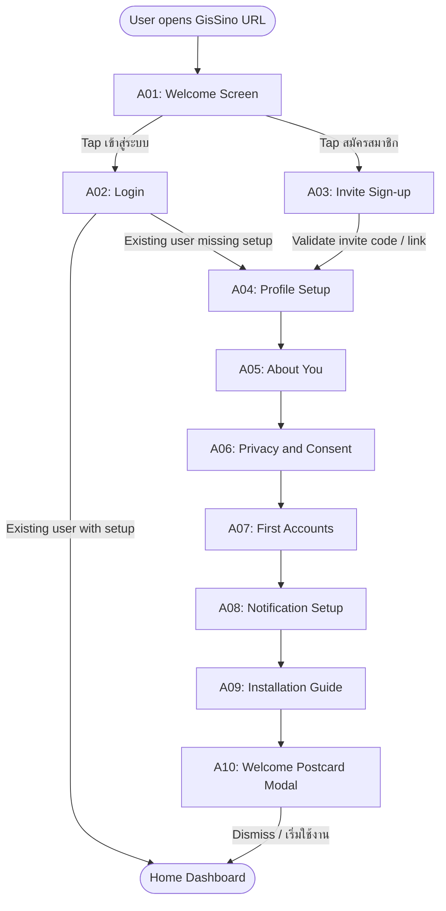
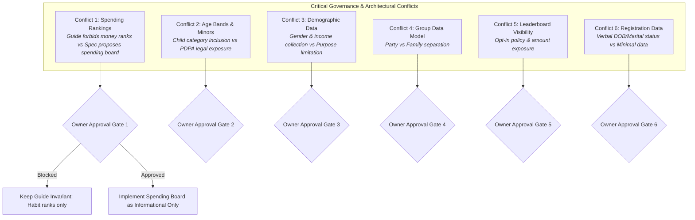

# Onboarding, Home v2, and Screen Roadmap Specification

> **Governance Notice:** This document establishes the technical and information architecture planning baseline for task **GS-PLAN-005**. It synthesizes existing repository truths, the mock-data UI baseline, and the owner's planning documents ([FEATURE_MAP.md](../project/FEATURE_MAP.md) and [HOME_AND_LEADERBOARD_SPEC.md](../project/HOME_AND_LEADERBOARD_SPEC.md)).
> **Execution Mode:** `PLAN_ONLY` / `DOCS_WRITE`. This specification describes planned UI screens, transitions, and backend milestones. It contains **no code implementation, no active API routes, no database migrations, and no live financial features**.
> Status tags follow [PROJECT_GUIDE.md](../project/PROJECT_GUIDE.md) §0: **[DECIDED]** = owner-approved requirement · **[PROPOSED]** = recommended engineering default · **[OPEN]** = unresolved question requiring owner decision.

---

## 1. Executive Summary and Architecture Stance

GisSino is a personal finance web application designed for everyday Thai life by one person, their family, and trusted friends. It is built as a mobile-first Progressive Web Application (PWA) with responsive desktop sidebar presentation.

This roadmap articulates the evolution from the current standalone mock-data UI prototype into a structured, multi-phase system across two parallel tracks:

1. **UI Prototype Track (S1–S7):** Buildless, in-memory, visual and interactive prototyping. Designed for rapid usability validation, spatial hierarchy testing, and client review. Every number, chart, and card must remain explicitly labeled as synthetic sample data.
2. **Production Track (M0–M11):** Self-hosted Docker container environment (`gissino-prod`) on the owner's Ubuntu mini-server, exposed exclusively via outbound Cloudflare Tunnel, backed by PostgreSQL, Argon2id/Passkey authentication, strict per-user authorization (BOLA prevention), and verifiable data backups.

The primary navigation remains invariant under [D23](../project/DECISIONS.md#d23--responsive-primary-navigation):
- **Mobile (<1100px):** Floating island navigation with 4 navigation slots (`Home`, `Wallet`, `Activity`, `More`) plus a separate elevated center circle `＋ Add`. Sub-pages (`Bills`, `Party`) reside inside `More`.
- **Desktop (≥1100px):** Collapsible/pinnable sidebar with 5 direct destinations (`Home`, `Wallet`, `Activity`, `Bills`, `Party`), with `＋ Add` as a dedicated 48px circular action in the top header.
- **Settings:** Accessible strictly via the profile avatar in the header, never as a primary navigation tab.

---

## 2. Pre-Home Flow Specification

The Pre-Home flow defines the user's initial encounter with GisSino, transitioning from public entry to an authenticated, personalized workspace.

### 2.1 Journey Overview



For existing returning users who have completed setup, authentication leads directly to `Home` (`#home`).
First-time registered users must complete the progressive setup sequence (A04 → A09) before receiving the Welcome Postcard (A10) and entering Home.

---

### 2.2 Screen Specifications (A01 – A10)

#### A01 — Welcome Screen (`#welcome`)
- **Purpose:** Introduce the product identity, build trust, and offer distinct authentication pathways.
- **Parent Navigation:** Standalone public landing view. No application navigation bars or sidebars rendered.
- **Key UI Elements:**
  - Metallic blue S-Shield brand glyph and bold **GisSino** typography.
  - Tagline: *"ปกป้องความมั่งคั่งในยุคเอเชีย"* ("Protecting Wealth in the Asian Era") [DECIDED].
  - Subtitle: *"เพื่อนคู่คิดทางการเงินที่เงียบสงบและปลอดภัย เพื่อชีวิตประจำวันของคุณและครอบครัว"* ("Calm and protective financial companion").
  - Primary Action: Large cobalt-enamel button *"เข้าสู่ระบบ"* (Log in) navigating to `#login`.
  - Secondary Action: Ghost capsule button *"สมัครสมาชิกด้วยรหัสเชิญ"* (Invite Sign-up) navigating to `#signup`.
  - Trust / Architecture notice: *"ระบบส่วนตัว ปลอดภัย ข้อมูลเป็นของคุณ"* (Private, safe, self-hosted).
- **Responsive Presentation:**
  - Mobile: Full viewport flex column, brand centered, actions anchored at thumb-reach zone.
  - Tablet/Desktop: Centered elegant enamel card (max-width 440px) against a deep navy slate background.
- **Implementation Status:** `PLANNED`.

#### A02 — Login Screen (`#login`)
- **Purpose:** Securely authenticate returning users via modern passwordless Passkey or credential pair.
- **Parent Navigation:** Child of `#welcome`. Back button returns to `#welcome`.
- **Key UI Elements:**
  - Passkey Quick Action: *"เข้าสู่ระบบด้วย Passkey"* (Fingerprint / Face ID / Security key). Primary recommended method for family members [DECIDED direction].
  - Divider: *"หรือใช้อีเมลและรหัสผ่าน"* (Or use email & password).
  - Input: Email address (with email validation format and auto-trimming).
  - Input: Password (with hide/show eye toggle).
  - Action link: *"ลืมรหัสผ่าน?"* (Forgot password).
  - Submit Button: *"เข้าสู่ระบบ"* (Log in).
- **States & Edge Cases:**
  - *Invalid credentials:* Generic Thai error message *"อีเมลหรือรหัสผ่านไม่ถูกต้อง กรุณาลองใหม่อีกครั้ง"* without leaking account existence.
  - *Rate-limited state (429):* Locked input with progressive countdown timer after 5 failed attempts.
  - *Service unavailable (503):* Informative error indicating home server maintenance or tunnel connector offline (Cloudflare error 1033).
  - *Success redirect:* Authenticated session set via `HttpOnly; Secure; SameSite=Lax` cookie. Redirects to `#home` (or `#setup` if `setup_completed_at` is null).
- **Security Boundary:** Handled in production milestone M1. No authentication logic exists in the current prototype.

#### A03 — Invite Sign-up Screen (`#signup`)
- **Purpose:** Restrict new account creation to invited members only [DECIDED invariant].
- **Parent Navigation:** Child of `#welcome`. Back button returns to `#welcome`.
- **Key UI Elements:**
  - Invitation Input: 6-character/token field or pre-filled from URL query parameter (`?invite=<code>`).
  - Validation Button: *"ตรวจสอบรหัสเชิญ"* (Validate code).
  - Credential Registration Form (revealed upon valid invitation):
    - Email address.
    - Password (strength indicator: minimum 10 characters, mixed case, numbers).
    - Optional prompt: *"สร้าง Passkey สำหรับอุปกรณ์นี้"* (Register Passkey immediately).
  - Secondary route: *"มีบัญชีอยู่แล้ว? เข้าสู่ระบบ"* (Already have an account? Log in).
- **States & Edge Cases:**
  - *Invalid/Used code:* Clear feedback *"รหัสเชิญนี้ไม่ถูกต้องหรือถูกใช้งานไปแล้ว กรุณาติดต่อผู้ดูแลระบบ"*.
  - *Expired code:* Invitation codes expire within 48–72 hours.
- **Security Boundary:** Passwords hashed with Argon2id server-side in M1.

#### A04 — Profile Setup (`#setup/profile`)
- **Purpose:** Establish the member's personal in-app identity without soliciting unnecessary personal information.
- **Parent Navigation:** Step 1 of First-time Setup wizard. Progress indicator: `1 / 6`.
- **Key UI Elements:**
  - Real Name / Formal Name: Used for personal records and greetings.
  - Display Nickname (*ชื่อเรียกในระบบ*): Primary name displayed on Home, Leaderboards, and Party feed (e.g., "คุณกิส", "แม่", "บอล"). Max 30 characters.
  - Avatar Picker: Selection of preset illustrated financial guardian avatars, metallic badges, or initial monogram. (Camera/custom photo upload deferred to prevent storage bloat).
- **Privacy Boundary:** Strictly scoped to display identity. No external social media links or phone numbers.

#### A05 — About You (`#setup/about`)
- **Purpose:** Collect coarse demographic parameters needed solely for age-categorized habit and spending boards [PROPOSED].
- **Parent Navigation:** Step 2 of First-time Setup wizard. Progress indicator: `2 / 6`.
- **Key UI Elements:**
  - Birth Year Picker (*ปีเกิด พ.ศ. / ค.ศ.*): Dropdown of years. Automatically displays derived category badge below:
    - *เด็ก (Child):* Age ≤ 12.
    - *วัยรุ่น / นักเรียน-นักศึกษา (Youth/Student):* Age 13–22.
    - *วัยทำงาน (Working Age):* Age 23–59.
    - *วัยเกษียณ (Retired):* Age 60+.
  - Gender Selection (*เพศ*): Options: *"ชาย"* (Male), *"หญิง"* (Female), *"ไม่ระบุ"* (Unspecified / Prefer not to say).
  - Estimated Monthly Income Range (*ช่วงรายได้ต่อเดือนโดยประมาณ*):
    - **Crucial Rule:** Rendered ONLY if the owner approves a percentage-based spending leaderboard (Conflict 1). If an absolute spending metric is chosen, this field is completely omitted.
    - If rendered, options are wide brackets (e.g., < ฿15,000, ฿15,000–฿30,000, ฿30,000–฿60,000, ฿60,000+), explicitly skippable, and marked as 100% private.
- **Critical Conflict & Clarification Note:**
  - The owner verbally mentioned full date of birth (DOB) and marital status during preliminary discussions.
  - **Decision Status:** Neither full DOB nor marital status is an established requirement. Collecting exact DOB creates elevated PDPA liability, and marital status has zero functional utility in the GisSino feature set. Both are classified as `PENDING CLARIFICATION / NOT APPROVED`.
  - Age category boundaries and minor signup eligibility remain subject to owner confirmation (Conflict 2).

#### A06 — Privacy and Consent (`#setup/consent`)
- **Purpose:** Provide transparent, plain-language disclosure of data practices and capture affirmative consent.
- **Parent Navigation:** Step 3 of First-time Setup wizard. Progress indicator: `3 / 6`.
- **Key UI Elements:**
  - Clear Thai Disclosure Cards:
    1. *ข้อมูลที่เก็บรวบรวม:* ปีเกิด (เพื่อจัดกลุ่มอายุ), ข้อมูลการเงิน (บัญชี, รายการ, บิล), ภาพถ่ายสลิปที่แนบ.
    2. *วัตถุประสงค์:* แสดงภาพรวมการเงินของคุณ และจัดอันดับความสม่ำเสมอในกลุ่มเพื่อน/ครอบครัวที่คุณยินยอม.
    3. *การมองเห็นข้อมูล:* รายการและยอดเงินจริงของคุณเป็น **ความลับส่วนบุคคล** สมาชิกอื่นจะไม่เห็นรายการของคุณ เว้นแต่คุณจะเปิดการมองเห็นเฉพาะจุด.
    4. *ภาพถ่ายสลิป:* จัดเก็บในเซิร์ฟเวอร์ส่วนตัว ไม่มีการสแกน OCR ไม่แชร์กับบุคคลภายนอก.
    5. *สิทธิและการลบข้อมูล:* คุณสามารถขอลบข้อมูลบัญชีและประวัติทั้งหมดได้ตลอดเวลาผ่านเมนูตั้งค่า.
  - Mandatory Interaction: Explicit checkbox *"ฉันได้อ่านและยินยอมให้ GisSino จัดเก็บและประมวลผลข้อมูลตามที่ระบุ"* (Tick to enable proceed button).
  - Minor / Guardian confirmation: If birth year indicates age < 15, prompt: *"ผู้ปกครองของผู้ใช้นี้รับทราบและอนุญาตให้ใช้งานระบบ"*.
- **Compliance Disclaimer:** Tagged as `VERIFY` under Thailand's Personal Data Protection Act (PDPA). Does not claim formal legal certification.

#### A07 — First Accounts Setup (`#setup/accounts`)
- **Purpose:** Initialize the user's ledger with foundational asset accounts so Home and Safe-to-Spend display real numbers immediately.
- **Parent Navigation:** Step 4 of First-time Setup wizard. Progress indicator: `4 / 6`.
- **Key UI Elements:**
  - Account Card Creator (pre-configured presets for quick addition):
    - *ธนาคาร (Bank):* Preset selector (SCB, KBank, BBL, KTB, TTB, etc.) from the approved [Provider Catalog](PROVIDER_CATALOG.md), optional account nickname, opening balance, currency (`THB` default, `USD` selectable).
    - *อีวอลเล็ต (E-Wallet):* Preset selector (TrueMoney, Rabbit Line Pay, ShopeePay), opening balance.
    - *เงินสด (Cash):* "เงินสดติดกระเป๋า", opening balance.
  - Summary preview showing aggregated opening balance.
- **Ledger Invariant:** Opening balance entries create foundational `ledger_entries` records (M2). Balances are never mutable loose numbers.

#### A08 — Notification Setup (`#setup/notifications`)
- **Purpose:** Configure timely reminders for obligations and streaks without relying on intrusive channels.
- **Parent Navigation:** Step 5 of First-time Setup wizard. Progress indicator: `5 / 6`.
- **Key UI Elements:**
  - In-App Inbox (*กล่องแจ้งเตือนในแอป*): Mandatory baseline, always active.
  - Web Push (*การแจ้งเตือนบนอุปกรณ์*): One-tap permission button (*"เปิดรับการแจ้งเตือน"*). Discloses iPhone requirement (must install to Home Screen first).
  - Email Digest (*สรุปรายสัปดาห์ทางอีเมล*): Optional toggle.
  - Daily Streak Reminder Time: Default preset at 20:00 (Asia/Bangkok).
- **Capability Disclosure:** Distinguishes implemented preview toggles from active background notification workers (scheduled for M6).

#### A09 — Installation Guide (`#setup/install`)
- **Purpose:** Guide the user to install the PWA to their device home screen for optimal native-like daily experience.
- **Parent Navigation:** Step 6 of First-time Setup wizard. Progress indicator: `6 / 6`.
- **Key UI Elements:**
  - OS Auto-detection tabs:
    - *Android:* Direct "Install Application" prompt trigger via `beforeinstallprompt` event.
    - *iOS (Safari):* Visual step-by-step card: Tap Share icon `[↑]` → Scroll and tap *"เพิ่มไปยังหน้าจอโฮม"* (Add to Home Screen) `[+]`.
    - *Desktop (Chrome/Edge):* Install button in browser URL bar or direct install button.
  - Action button: *"เสร็จสิ้นการตั้งค่า"* (Complete setup).

#### A10 — Welcome Postcard (`#postcard` / modal overlay)
- **Purpose:** Celebrate successful onboarding with a calm, warm, protective welcome message before landing on the dashboard.
- **Parent Navigation:** Modal overlay directly preceding Home view.
- **Key UI Elements:**
  - Elegant enamel postcard card design with metallic gold/blue seal.
  - Personalized copy: *"ยินดีต้อนรับสู่ GisSino, คุณกิส — พื้นที่ปลอดภัยทางการเงินของคุณพร้อมใช้งานแล้ว"*
  - Quick tips capsule (3 glanceable bullet points):
    1. จดรายการง่ายๆ เพียงไม่กี่วินาที
    2. เช็ก "เงินที่ใช้ได้จริง" ก่อนตัดสินใจใช้จ่าย
    3. รักษาบันทึกต่อเนื่องเพื่อสะสมสตรีกและเหรียญรางวัล
  - Dismiss Action: Large button *"เริ่มต้นใช้งาน"* (Proceed to Home).
- **Persistence Boundary:** In prototype, dismisses to in-memory state. In production M1, sets persistent boolean `welcome_seen_at = NOW()` on the user record so it is presented exactly once.

---

## 3. Home Current-State Inventory

The following audit compares the currently running UI implementation (`src/blue-screens.js`, `src/screens.js`, `src/account-board.js`, `src/account-deck.js`) against the requirements of the Project Guide and owner screenshots.

| # | Home UI Element | Present in UI | Preview-Only Behavior | Tested Functionality | Backend Dependency | Known Limitation | Intended Destination |
|---|---|---|---|---|---|---|---|
| 1 | Greeting / Header | Yes | Renders static greeting "ยินดีต้อนรับกลับ" and mock profile name "คุณกิส" | Verified in unit test (`screens.js`) | `users.display_name`, session context | Hardcoded mock profile text | Opens `#settings` via profile disc |
| 2 | Trophy / Party Entry | Yes | Icon button in header bar | Renders icon plate | `user_stats`, `party_members` | Fixed sample route `#party` | Navigates to `#party` |
| 3 | Notification Bell | Yes | Bell button with unread styling | Click triggers notifications modal | `notifications` inbox table | Modal shows empty/sample state only; no live push | Opens notifications modal |
| 4 | Total Balance Card | Yes | Displays THB 116,850.00 in cobalt enamel hero card | Balance formatting and minor-unit conversion tested | Ledger engine (`accounts` + `ledger_entries`) | Calculated from static fixtures; does not deduct credit card liability | `#home` hero element |
| 5 | Hide / Show Balance Toggle | Yes | Eye icon toggles between visible amount and masked `••••••` | Masking logic tested across Home, Wallet, and Detail | Local UI state (`state.balanceVisible`) | Session memory only; resets on page reload | In-place card toggle |
| 6 | Quick Actions Strip | Yes | 4 pill buttons: รายจ่าย, รายรับ, โอนเงิน, บิล | Click dispatches modal mode or navigation route | `transactions`, `accounts`, `obligations` | Expense/income open unsaved modal; transfer opens preview screen; bills navigates | Expense/Income → Add modal; Transfer → `#transfer`; Bills → `#bills` |
| 7 | My Accounts Folders | Yes | S3 complete overlapping folder deck (vertical default, horizontal Settings) | Full deck gestures, bounds, continuous drag, 34 tests green | `accounts` table, provider registry | Synthetic fixtures only; creation/edit is session-only | Selected folder detail → `#wallet/account/<id>` |
| 8 | Account Detail Entry | Yes | Explicit detail link and active-folder double-tap | Opens Wallet detail view with correct account context | Accounts query, ledger balance | Read-only synthetic view; no live reconcile | `#wallet/account/<id>` |
| 9 | Recent Transactions | Yes | 3 recent transaction rows with icon, category, note, amount | Formatted list rendering tested | `transactions` table (limit 3) | Static fixtures; cannot click to edit; pagination absent | "ดูทั้งหมด" → `#activity` |
| 10 | Safe to Spend Tile | Yes | Displays mock ฿14,500 under mini summary | Display amount formatting tested | Obligation engine + Ledger balance | Hardcoded static fixture; no live calculation | Navigates to `#activity` (should be `#wallet` or detail) |
| 11 | Upcoming Obligations | Yes | Displays mock ฿8,250 under mini summary | Formatted amount rendering tested | `obligations` schedule (unpaid due this month) | Displays aggregate number only; does not name specific bill | Navigates to `#bills` |
| 12 | Monthly Summary & Bars | Yes | Section with month's expense (฿18,420) + 7-day spending bars | Bar height rendering and accessible labels tested | Daily transaction aggregation job | Takes substantial vertical space; bars represent hardcoded synthetic data | To be moved in v2 to Activity Summary tab |
| 13 | Streak & Freeze Indicator | Yes | Capsule showing "7 วัน" streak, flame icon, "พักได้ 2 ครั้ง" | Formatting and icon rendering tested | `streak_state` table + daily rollover job | Static values; clicking opens `#party` | Navigates to `#party` |
| 14 | Synthetic Data Warning | Yes | Shield pill with copy "ตัวอย่างข้อมูลสำหรับทดสอบดีไซน์" | Verified across test suite; required under Honest UI | None (client-side preview banner) | Must be removed when production data arrives | Static footer note |

---

## 4. Home v2 Specification

Home v2 refines the dashboard hierarchy to focus on daily actionable priorities, moving secondary analytical data to the Activity tab and adding privacy-respecting community motivation.

### 4.1 Block Layout (Top to Bottom)

```text
┌────────────────────────────────────────────────────────┐
│ 1. Header (Greeting, Avatar → Settings, Trophy, Bell)  │
├────────────────────────────────────────────────────────┤
│ 2. Total Balance Card (THB, Hide/Show Eye, Month Tag)   │
├────────────────────────────────────────────────────────┤
│ 3. Quick Actions (รายจ่าย / รายรับ / โอนเงิน / บิล)     │
├────────────────────────────────────────────────────────┤
│ 4. Today Strip [NEW] (Conditional: Due, Streak, Detail)│
├────────────────────────────────────────────────────────┤
│ 5. Decision Dual-Tile: Safe to Spend + Nearest Obligation│
├────────────────────────────────────────────────────────┤
│ 6. Streak Card with Primary Party Rank Line [NEW]      │
├────────────────────────────────────────────────────────┤
│ 7. My Accounts Overlapping Folder Deck (PR #4 baseline)│
├────────────────────────────────────────────────────────┤
│ 8. Recent Transactions (3 items + View All)            │
├────────────────────────────────────────────────────────┤
│ 9. One-Line Monthly Summary Link [NEW]                 │
├────────────────────────────────────────────────────────┤
│ 10. Compact Global Leaderboard Card [NEW / PLANNED]    │
└────────────────────────────────────────────────────────┘
```

> **Constraint:** Weekly Mission card remains `OPTIONAL / PROPOSED` for future iteration. Home must remain a fast daily glance, not an overcrowded portal.

---

### 4.2 Block Contracts and Behaviors

#### Block 1 — Header
- **Elements:** Profile button (avatar disc, "ยินดีต้อนรับกลับ", nickname), Trophy button (opens `#party`), Notification bell (with unread indicator dot), and Desktop Add circle (on ≥1100px).
- **Destination:** Profile tap opens `#settings`; Trophy opens `#party`; Bell opens notification sheet.

#### Block 2 — Total Balance Card
- **Elements:** Large balance display, THB badge, eye hide/show toggle, subtle wave enamel background.
- **Calculation Rule:** Sum of all liquid asset accounts (Bank + E-Wallet + Cash).
- **Open Decision:** Clarify whether total balance should display Gross Assets or Net Worth (Gross Assets − Credit Card Liabilities). See Open Questions Q10.

#### Block 3 — Quick Actions
- **Elements:** 4 action buttons:
  - `รายจ่าย` (Expense) → Triggers Add modal with expense form preset.
  - `รายรับ` (Income) → Triggers Add modal with income form preset.
  - `โอนเงิน` (Transfer) → Navigates to `#transfer` (own-account transfer).
  - `บิล` (Bills) → Navigates to `#bills`.

#### Block 4 — Today Strip (`#today-strip`) [NEW]
- **Purpose:** Surface urgent daily tasks and risks requiring immediate user attention.
- **Display Conditions (OR logic):**
  1. Any obligation due within 3 days or currently overdue.
  2. Streak at risk (no qualifying action logged today and local time > configurable reminder time, e.g. 20:00).
  3. One or more transactions flagged with status `needs_details` (*รอเติมรายละเอียด*).
  4. Explicit reminder if no transactions or check-in recorded today.
- **Empty State Rule:** If none of the qualifying conditions are met, **the entire strip is completely hidden** (height: 0, no DOM placeholder rendered).
- **Tappable Triggers:**
  - Due obligation tap → Navigates to `#bills` with the urgent item highlighted.
  - Streak at risk tap → Opens Add sheet to log entry or tap "วันนี้ไม่ใช้จ่าย".
  - Needs details tap → Navigates to `#activity?filter=needs_details`.

#### Block 5 — Safe to Spend and Nearest Obligation
- **Layout:** Side-by-side dual tile container.
- **Tile 5A: Safe to Spend (*เงินที่ใช้ได้จริง*):**
  - *Formula:* $\text{Safe to Spend} = \sum(\text{Liquid Assets}) - \sum(\text{Unpaid Obligations Due in Current Month})$.
  - *Tap Destination:* Navigates to `#wallet` (assets overview) or `#bills`.
  - *Edge States:* If negative, displays ฿0.00 with warning color (Crimson) and helper text *"เงินสำรองติดลบ กรุณาตรวจสอบภาระบิล"*. Never hides the negative reality.
  - *Backend Dependency:* Requires real-time aggregation across ledger accounts and obligations schedule.
- **Tile 5B: Nearest Obligation (*ภาระใกล้ครบกำหนด*):**
  - *Design Update:* Replaces aggregate figure with the specific closest unpaid obligation.
  - *Elements:* Obligation title (e.g., "บัตรเครดิต KBank"), formatted due date, amount, and badge indicating remaining days (e.g., *"อีก 2 วัน"*, *"วันนี้"*, *"เลยกำหนด"*).
  - *Tap Destination:* Navigates to `#bills` focusing on that obligation.
  - *Empty State:* Displays *"ไม่มีภาระใกล้ครบกำหนด"* with a checkmark badge.

#### Block 6 — Streak with Party Rank [NEW]
- **Elements:** Flame icon, current streak count ("7 วัน"), rest freezes available ("พักได้ 2 ครั้ง"), and a dedicated secondary line:
  - Line format: `สตรีก 7 วัน · อันดับ 2 ในปาร์ตี้ครอบครัว`
- **Party Source Rule:** Rank is derived from the user's **primary party** streak standings.
- **Edge State:** If user belongs to no party, the rank text is cleanly omitted, showing only the personal streak metrics.
- **Tap Destination:** Navigates to `#party`.

#### Block 7 — My Accounts Overlapping Folder Deck
- **Preservation Directive:** Preserves the complete overlapping folder deck delivered and merged in **PR #4** (`TASK-GS-UI-ACCOUNT-BOARD-001`).
- **Interaction Contract:**
  - Vertical overlapping deck by default (24px tab exposures below 520px container width; 28px above).
  - Horizontal mode selectable exclusively in Settings.
  - Continuous drag gestures via requestAnimationFrame with 240ms ease-out snap.
  - Selection overlay preserves selected account ID without navigating away from Home.
  - Explicit detail button and active-folder double-click navigate to `#wallet/account/<id>`.
  - **No redesign or replacement of this component is permitted under this task.**

#### Block 8 — Recent Transactions
- **Elements:** Header with *"รายการล่าสุด"* and *"ดูทั้งหมด"*; 3 most recent transactions with provider/category icon, title, date/time, and formatted amount (+income / -expense).
- **Tap Destination:** Individual transaction opens detail sheet; "ดูทั้งหมด" navigates to `#activity`.

#### Block 9 — One-Line Monthly Summary [NEW]
- **Design Evolution:** The large monthly summary box and 7-day bar chart are removed from Home.
- **Replacement:** A sleek, single-line enamel capsule:
  - Copy: `สรุปรายจ่ายเดือนตุลาคม: ฿18,420 · ดูกราฟและหมวดหมู่ →`
- **Tap Destination:** Navigates to the new **Activity Summary Tab** (`#activity/summary`).
- **Empty State:** If no transactions exist, displays *"ยังไม่มีรายการใช้จ่ายเดือนนี้"*.

#### Block 10 — Compact Global Leaderboard Card [NEW / PLANNED]
- **Design Intent:** Friendly, privacy-respecting community motivation.
- **Status:** **PLANNED / DRAFT**. Subject to resolution of Conflict 1.
- **Card Elements:**
  - Header: *"กระดานจัดอันดับ"* with "ดูทั้งหมด" link to `#leaderboard`.
  - Category Filter Chips: `รวม (Overall)` + Age Category chips (`เด็ก`, `วัยรุ่น`, `วัยทำงาน`, `วัยเกษียณ`).
  - Period Chips: `วัน (Day)` · `สัปดาห์ (Week)` · `เดือน (Month)` · `ปี (Year)`.
  - Content Rows: Top 3 members plus current user's personal row.
  - Row Data: Rank number, display nickname, avatar disc, age category badge.
  - **Privacy Rule:** Monetary amounts are strictly hidden by default. Only ranks are displayed.
  - **Opt-in Gate:** If user has not opted into the leaderboard, card displays an educational invitation with button *"เข้าร่วมกระดาน"* (no rankings shown until consented).
  - Sample disclaimer footer: *"ตัวอย่างข้อมูลสำหรับทดสอบดีไซน์"*.

---

## 5. Expanded Feature and Screen Map

The following table defines the 10 new and extended system destinations.

| # | Destination | Type | Parent Nav | Purpose | Main Sections | Primary User Actions | Data Dependencies | Empty / Error States | Privacy & Security | Implementation Status | Milestone | Decision Gates |
|---|---|---|---|---|---|---|---|---|---|---|---|---|
| 1 | **Activity Summary Tab** | Full Page Tab | Activity (`#activity`) | Deep-dive monthly analytics without cluttering Home | Month selector, Income vs Expense split, 7-day spending chart, Category breakdown | Change month, switch between List and Summary tabs | `transactions` aggregate by category & day | "ไม่มีข้อมูลการใช้จ่ายในเดือนนี้" | Scoped to authenticated user's own data only | `DESIGNED` | M3 / S2 | Tab placement confirmed |
| 2 | **Leaderboard Page** | Full Page | Header trophy / Home card / More | Complete community habit and spending rankings | Tabs: Global vs My Friends; Filter chips: Category, Period, Metric (Streak, On-time, Spending) | Toggle tabs, select filters, inspect rank | `user_stats` table only; never raw transactions | Not opted in CTA; Empty category state | Reads aggregates only; no amounts unless Full visibility; no gender | `DRAFT / PLANNED` | M8 / S3 | **Conflict 1 & 5** (Spending metrics & opt-in) |
| 3 | **Friends Page** | Full Page | Party (`#party`) / More | Connect with trusted peers for shared encouragement | Friend list, Pending requests, Search/Add bar, 6-digit invite code card | Search by exact name/code, accept/decline request, remove/block friend | `friendships` table (`user_id`, `friend_id`, `status`) | "ยังไม่มีเพื่อนในระบบ", "ไม่พบผู้ใช้ที่ค้นหา" | Search shows only nickname + avatar; no directory browsing; rate-limited | `DESIGNED` | M8 / S5 | Exact code search & anti-harassment rules |
| 4 | **Party Creation** | Modal / Overlay | Party (`#party`) | Create custom friend groups for shared habit tracking | Group name input, Group avatar/icon, Friend invite multi-select | Enter group title, pick icon, dispatch invites | `parties` table (`kind = 'party'`) | Validation error if name is empty | Membership isolated; joining leaves personal ledger private | `DESIGNED` | M8 / S5 | **Conflict 4** (Party vs Family data model) |
| 5 | **Family Creation** | Modal / Overlay | Party (`#party`) | Establish household unit with shared habit context | Family name input, Member invite, Household role assignment | Create family group, generate QR/link | `parties` table (`kind = 'family'`) | Validation error if name is empty | Same strict privacy invariants; no raw financial leakage | `DESIGNED` | M8 / S5 | **Conflict 4** (Shared group entity) |
| 6 | **Visibility Settings** | Modal / Sheet | Party (`#party`) / Settings | Granular user control over shared data and rankings | 3 Tiers: Private / Status Only / Full; Spending board opt-in toggle; Shared figure checkboxes | Select tier, toggle opt-in switches, save preferences | `party_members` visibility flags, `user_stats` opt-in | Default: Status Only; Spending board: OFF | Enforcement in query layer; private members excluded from boards | `DESIGNED` | M8 / S3 | Invariant 6.4-3 (Itemized data never shared) |
| 7 | **Notification Inbox** | Sheet / Modal | Header Bell (`#notifications`) | Consolidated, reliable history of all alerts and reminders | Today's alerts, Earlier this week, Mark all as read, Settings shortcut | Tap alert to jump to source item, dismiss alert | `notifications` table (`user_id`, `read_at`) | "ไม่มีการแจ้งเตือนใหม่" | Personal notification history only | `DESIGNED` | M6 | Email/push fallback reliability |
| 8 | **Welcome Postcard** | Modal Overlay | Setup finish (`#postcard`) | Warm, celebratory welcome after completing setup | Welcome illustration, personalized greeting, 3 quick tips, Start button | Tap *"เริ่มต้นใช้งาน"* to enter Home | User profile name, `welcome_seen_at` | Fallback if profile name missing | Shown strictly once per account | `DESIGNED` | M1 / S6 | Mock in S6; DB persistence in M1 |
| 9 | **What's New Announcements** | Modal / Banner | Home startup | Deliver version updates and feature notices without app redeploy | Announcement card, illustration, feature bullet points, Dismiss button | Read notice, tap dismiss, optional feature link | `announcements` and `announcement_reads` tables | Suppressed if no active unread announcements | Announcements managed by admin; data-driven | `PROPOSED` | M10 | Admin panel data model |
| 10 | **PWA Update Notification** | Toast / Banner | Bottom floating bar | Inform user that a new application build is available | Notice text: *"มีเวอร์ชันใหม่ — แตะเพื่ออัปเดต"*, Refresh button | Tap to activate new Service Worker and reload | Service worker registration lifecycle | Hidden when client is on latest build | Purely client-side cache refresh | `DESIGNED` | M10 | Cache invalidation strategy |

---

## 6. Critical Conflict Analysis and Owner Approval Gates

The introduction of `FEATURE_MAP.md` and `HOME_AND_LEADERBOARD_SPEC.md` creates six specific tensions with the approved [PROJECT_GUIDE.md](../project/PROJECT_GUIDE.md) and [SYSTEM_ARCHITECTURE.md](../architecture/SYSTEM_ARCHITECTURE.md).

These conflicts must be resolved by explicit owner decision. **No coding agent may implement these contested features until approval is recorded.**



### Conflict 1 — Spending Rankings vs. Project Guide Invariants
- **Approved Invariant:** [PROJECT_GUIDE.md](../project/PROJECT_GUIDE.md) §6.4 Invariant 2 explicitly commands: *"Rankings are based on habits, never on balance, income, spending or net worth."* Violating this is classified as a bug.
- **Proposed Draft Behavior:** [HOME_AND_LEADERBOARD_SPEC.md](../project/HOME_AND_LEADERBOARD_SPEC.md) D-I proposes spending-based leaderboards by day, week, month, and year.
- **Privacy & Psychological Implications:**
  - Ranking members by money amounts creates financial shaming, competitive spending distortions, and privacy leaks.
  - Wealthier users naturally outspend students, rendering absolute boards demoralizing.
- **Analyst Recommendation:**
  1. If spending rankings are approved, they must rank **percentage of personal income or budget saved** rather than raw Baht spent.
  2. Alternatively, if absolute spending is kept, it must remain strictly **informational position only**: no XP, no trophies, no badges, and hidden amounts.
  3. **Implementation Status:** `BLOCKED` until the owner officially amends Invariant 6.4-2 in `DECISIONS.md`.

### Conflict 2 — Age Categories and Minors
- **Proposed Draft Behavior:** Birth year is collected to segment users into 4 categories (`Child` ≤12, `Youth` 13–22, `Working` 23–59, `Retired` 60+).
- **Regulatory Conflict:** Thailand's Personal Data Protection Act (PDPA) enforces rigorous consent requirements for minors under 10, 15, and 20 years old. Storing child financial habits and images without verifiable parental consent creates severe compliance liability.
- **Required Approval:**
  - Define minimum signup age (e.g., age 13 or 15).
  - Decide whether Child (<13) is a standalone board or merged into Youth.
  - Establish adult guardian verification flow.
  - Status: Marked as `VERIFY` under PDPA.

### Conflict 3 — Gender and Income Data Collection
- **Proposed Draft Behavior:** Collect gender ("ชาย", "หญิง", "ไม่ระบุ") and optional income bracket during onboarding.
- **Data Minimization Principle:** [PROJECT_GUIDE.md](../project/PROJECT_GUIDE.md) §4 Principle 6 dictates Privacy by Construction and minimal data collection.
- **Strict Boundary:**
  - Gender has zero architectural utility in balance calculation, habit streaks, or transaction logging.
  - **Non-negotiable Rule:** Gender must **never** be used for friend suggestions, automated matchmaking, or public profile displays.
  - Gender must remain 100% optional with default "ไม่ระบุ".
  - Income bracket may only be requested if Conflict 1 selects a percentage metric. Otherwise, it must be removed.

### Conflict 4 — Party versus Family
- **Proposed Draft Behavior:** Support creating both a "Party" and a "Family".
- **Architectural Conflict:** Building two distinct database models and UI suites duplicates maintenance effort for a solo developer.
- **Analyst Recommendation:**
  - Use a single database table `parties` with a discriminator column `kind ∈ {'party', 'family'}`.
  - A Family is simply a Party with a family badge and household defaults.
  - Status: `PROPOSED` awaiting owner confirmation.

### Conflict 5 — Spending Board Visibility and Opt-In Defaults
- **Proposed Draft Behavior:** Spending boards available globally and within friends.
- **Approved Invariant:** Every user's personal financial transactions must remain hermetically sealed.
- **Enforcement Rule:**
  - Participation in any spending board must be **strictly opt-in, default OFF**.
  - Opting in shares only position and category. Individual transaction rows are **never** queried or exposed by the leaderboard layer.

### Conflict 6 — Verbal Birth Date and Marital Status Mentions
- **Discussion Context:** The owner verbally mentioned collecting full Date of Birth and Marital Status.
- **Specification Finding:** Written project documents specify only birth year and gender.
- **Resolution:** Full DOB and marital status are **excluded** from this specification. They add privacy friction without functional benefit. Recorded as `PENDING CLARIFICATION / NOT APPROVED`.

---

## 7. Dual-Track Implementation Roadmap

To maintain rapid UI iteration while guaranteeing robust backend security, implementation is partitioned into two distinct tracks.

```text
UI PROTOTYPE TRACK (Buildless Mock UI)          PRODUCTION BACKEND TRACK (Docker / Postgres)
─────────────────────────────────────          ───────────────────────────────────────────
S1: Home v2 Visual Layout                      M0: Dev Foundation (Docker, Postgres, CI)
S2: Activity Summary Tab                       M1: Auth Core (Passkey, Argon2id, BOLA Tests)
S3: Leaderboard Mock Views                     M2: Ledger Engine (Double Entry, Invariants)
S4: Leaderboard Home Card                      M3: Activity & Manual Entry (Slips, Tags)
S5: Friends & Group Creation UI                M4: FX Service (Daily USD/THB API)
S6: Onboarding Wizard & Postcard               M5: Obligations Engine (Auto Subscriptions)
S7: Documentation Vault Final Sync             M6: Reminders & Notifications (Push, Email)
                                               M7: Habit Engine (Rollover, Streak, Freezes)
                                               M8: Party & Leaderboard Service (Aggregates)
                                               M9: AI Assistant (Drafts, Safe Queries)
                                               M10: PWA Polish & Admin Console
                                               M11: Production Deployment & Restore Drill
```

### 7.1 UI Prototype Track (Mock Slices)

| Slice | Scope & Deliverable | Exit Criteria |
|---|---|---|
| **S1 — Home v2 Reorganization** | Reorder blocks to 1–10; implement Today strip preview; nearest obligation naming; streak rank line; single-line month summary. | Matches Section 4 order; empty states tested; responsive at 320–1920px; PR #4 account folders preserved. |
| **S2 — Activity Summary Tab** | Add Summary tab to `#activity`; relocate 7-day spending chart and month summary; ensure seamless transition from Home link. | Tab navigation clean; no chart duplication; passes `npm run check`. |
| **S3 — Leaderboard Page Preview** | Implement `#leaderboard` with Global and My Friends tabs, category chips, period chips, and mock member cards. | Position-only display; no live money values; opt-in toggle simulation; accessible keyboard control. |
| **S4 — Home Leaderboard Card** | Embed compact Global Leaderboard card into bottom of Home v2 using shared S3 components. | Matches Home theme; tap "ดูทั้งหมด" navigates to S3 `#leaderboard`. |
| **S5 — Friends & Group Creation UI** | Mock friend search by exact name / 6-digit code; mock requests list; Party and Family creation modal dialogs. | Search requires exact match; privacy boundaries respected; no data persistence claimed. |
| **S6 — Onboarding Wizard & Postcard** | Build interactive `#welcome`, `#login`, `#signup`, 6-step `#setup` flow, and `#postcard` modal. | Step-by-step navigation; birth-year age categorization; dismissible postcard proceeds to Home. |
| **S7 — Vault Documentation Reconcile** | Reconcile all page notes, screen maps, and worklog receipts. | Zero broken links; full graph health; owner review. |

### 7.2 Production Track (Backend Milestones)

| Milestone | Title | Scope & Acceptance Criteria |
|---|---|---|
| **M0** | Development Foundation | Docker Compose local stack (app, worker, postgres); migration runner; baseline test suite against real PostgreSQL. |
| **M1** | Authentication & Security | Invite-only code validation; Argon2id passwords; WebAuthn Passkeys; BOLA cross-user authorization test suite; setup state tracking. |
| **M2** | Accounts & Ledger Engine | Double-entry ledger core; transfers between own accounts; adjustments/reconcile; integer minor-unit balance calculation. |
| **M3** | Activity & Attachments | Transaction logging; categories and tags; slip attachment (magic bytes, EXIF stripped, no OCR); `needs_details` inbox. |
| **M4** | Foreign Exchange (FX) | Scheduled daily USD→THB fetch; rate history snapshotting; fallback chain; manual override. |
| **M5** | Obligations Engine | Subscriptions auto-posting sweep (idempotent); installment schedules; credit card statement/due tracking; bill reminders. |
| **M6** | Notifications & Reminders | Three-stage dispatcher (T-3, Due, Overdue); in-app inbox; Web Push VAPID delivery; email digests. |
| **M7** | Habit & Gamification Engine | Midnight Asia/Bangkok rollover; automatic streak freeze consumption; XP deduplication; badge awards; `user_stats` updates. |
| **M8** | Party & Leaderboard Service | Party creation; membership invites; aggregate-only ranking queries; visibility query filtering; activity feed. |
| **M9** | AI Money Assistant | Provider interface; Thai text parsing into drafts; safe read-only SQL queries; prompt-injection guardrails. |
| **M10** | PWA & Admin Console | Service worker caching; install prompts; admin user/invite management; data-driven announcement engine. |
| **M11** | Production Hardening | Cloudflare Tunnel setup; host firewall hardening; automated encrypted backups; documented off-host restore drill. |

---

## 8. Documentation Precedence and Source-of-Truth Rules

In accordance with [VAULT_RULES.md](../governance/VAULT_RULES.md) and [AGENTS.md](../../AGENTS.md):
1. **Canonical Invariants:** [PROJECT_GUIDE.md](../project/PROJECT_GUIDE.md) and [SYSTEM_ARCHITECTURE.md](../architecture/SYSTEM_ARCHITECTURE.md) remain the supreme architectural authority.
2. **Draft Specifications:** [HOME_AND_LEADERBOARD_SPEC.md](../project/HOME_AND_LEADERBOARD_SPEC.md) and this roadmap document are change specifications. Where they conflict with canonical invariants (e.g., spending rankings), the canonical rule stands until explicitly amended by the owner in [DECISIONS.md](../project/DECISIONS.md).
3. **Living Specs vs. Log Notes:**
   - This document and [SCREEN_MAP.md](SCREEN_MAP.md) are living design specifications updated in place.
   - Tasks, sessions, and receipts in `docs/worklog/` are immutable historical records.

---

## 9. Change Log

- 2026-10-17 — Initial creation for task **GS-PLAN-005**. Established Pre-Home flow, Home v2 block specification, 10-screen feature map, critical conflict analysis, and dual-track implementation roadmap.
