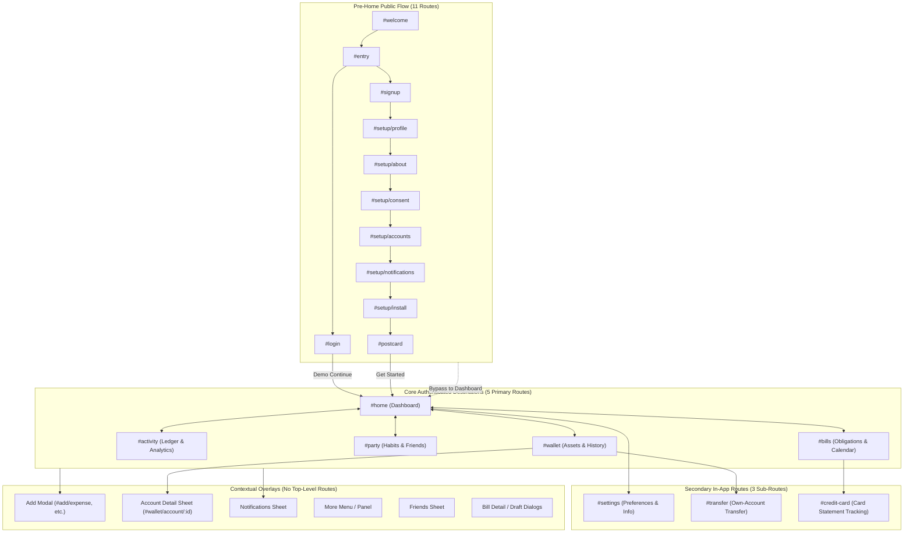
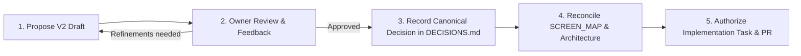

# GisSino — Product-Wide UX/UI Planning V2

> **Scope:** Documentation and UX/IA planning only. **No implementation approval, no application code, no database migrations, and no production or infrastructure changes.**
>
> **Planning workspace:** This document establishes the master product-wide UX/UI planning workspace for GisSino. It inventories all existing application surfaces, cross-page flows, and verified functions grounded in the current post-WP-20 prototype baseline (`1163e98`). It defines an owner review queue to plan future design evolutions **one small slice at a time**.
>
> **Slice 1 focus:** Responsive Navigation V2 is the only section currently drafted in full detail (see companion note [`NAVIGATION_RESPONSIVE_V2_PLAN.md`](NAVIGATION_RESPONSIVE_V2_PLAN.md)). All other pages remain an accurate baseline inventory awaiting owner review, with **Home Dashboard** designated as the next planning slice.

---

## 1. Objective, Authority, and Planning Boundaries

1. **Objective:** Provide a structured, reviewable planning environment where the owner and engineering agents can systematically document, evaluate, and refine user experiences across all devices and application pages before executing code changes.
2. **Authority and Governance:** This document operates under the authority of [`PROJECT_GUIDE.md`](../project/PROJECT_GUIDE.md), [`SYSTEM_ARCHITECTURE.md`](../architecture/SYSTEM_ARCHITECTURE.md), and [`DECISIONS.md`](../project/DECISIONS.md). Status tags follow canonical rules:
   - `[DECIDED]`: Approved repository invariant or owner decision.
   - `[PROPOSED]`: Recommended engineering candidate or owner-directed draft for review.
   - `[OPEN]`: Unresolved question requiring owner decision or technical exploration.
3. **No Confusion with Historical Page Tasks:** This product-wide planning effort does not overwrite or replace the historical merged milestones (`Home v2`, `Wallet v2`, `Activity v2`, `Bills v2`, `Party v2`, `WP-01 Audit`, `WP-20 QA`). Those milestones represent verified prototype increments whose functional baselines are preserved here.
4. **Synthetic Prototype Truth:** The current codebase is a buildless vanilla HTML/CSS/JavaScript Progressive Web Application (PWA) with synthetic, in-memory data fixtures. It does **not** include a live finance backend, database persistence, real banking integrations, OCR slip parsing, or multi-user cross-account authorization. All planning references maintain this honest distinction.

---

## 2. Non-Duplicate Relationship to Existing Documents

This document complements and links directly to existing vault authorities without duplicating them:

- [`PROJECT_GUIDE.md`](../project/PROJECT_GUIDE.md): Defines product philosophy, core invariants, target personas, and scope guardrails.
- [`SYSTEM_ARCHITECTURE.md`](../architecture/SYSTEM_ARCHITECTURE.md): Specifies the target production architecture, self-hosted Docker stack, Cloudflare Tunnel, PostgreSQL ledger engine, and M0–M11 delivery milestones.
- [`DECISIONS.md`](../project/DECISIONS.md): Canonical log of binding architectural and design decisions (D1–D37).
- [`SCREEN_MAP.md`](SCREEN_MAP.md): Technical routing table, history contracts, and screen relationships.
- [`COMPONENT_INVENTORY.md`](COMPONENT_INVENTORY.md): Catalog of shared UI components and interactive widgets.
- [`UI_DATA_CONTRACTS.md`](UI_DATA_CONTRACTS.md): Data structures, minor-unit money handling, and Fixture World boundaries.
- **Distinction from [`ONBOARDING_HOME_V2_ROADMAP.md`](ONBOARDING_HOME_V2_ROADMAP.md) (GS-PLAN-005):** GS-PLAN-005 was created on 2026-10-17 as an initial planning draft for pre-Home flow and Home v2. Since then, the repository has implemented and merged major milestones: Welcome S4 (`bb27e28`), Home v2 S3 (`175677c`), Wallet v2 S2 (`90a81e8`), Activity v2 S1 (`18e087e`), Bills v2 S1 (`40d52ff`), Party v2 S1 (`cd1fa82`), WP-01 logic/data audit (`bdbedae`), and WP-20 QA round 2 (`d079561`). `PRODUCT_UX_V2_PLAN.md` does not repeat the historical roadmap; it establishes a fresh, up-to-date product-wide V2 planning framework anchored in the true current implementation.

---

## 3. Source-Derived Screen Inventory & Navigation Architecture

The application exposes a precise hierarchy of routes, sub-routes, and overlays. It does **not** have 19 top-level tabs. The IA consists of 5 main destinations, 3 secondary sub-routes, 11 pre-main public routes, and shared contextual overlays.



### 3.1 Route Taxonomy & Hierarchy

| Category | Route / Hash | Name / Purpose | Navigation Access (Canonical D23) | Navigation Access (Proposed V2) |
|---|---|---|---|---|
| **Main Destination** | `#home` | Dashboard, hero balance, accounts, due soon, habits, recent | Bottom tab #1 (mobile) / Sidebar #1 (desktop) | Bottom tab #1 (phone/tablet) / Sidebar #1 (desktop) |
| **Main Destination** | `#activity` | Activity list, filters, search, embedded monthly donut | Bottom tab #3 (mobile) / Sidebar #3 (desktop) | Bottom tab #2 (phone/tablet — **reordered**) / Sidebar #2 |
| **Main Destination** | `#wallet` | Asset breakdown (Bank/Wallet/Cash), monthly snapshots | Bottom tab #2 (mobile) / Sidebar #2 (desktop) | Bottom tab #3 (phone/tablet — **reordered**) / Sidebar #3 |
| **Main Destination** | `#bills` | Obligation list, calendar view, 4 draft forms | In `#more` (mobile) / Sidebar #4 (desktop) | In `#more` (phone/tablet) / Sidebar #4 (desktop) |
| **Main Destination** | `#party` | Streak, XP, badges, Friends & Global weekly rankings | In `#more` (mobile) / Sidebar #5 (desktop) | In `#more` (phone/tablet) / Sidebar #5 (desktop) |
| **Sub-Route** | `#settings` | Theme, locale, folder mode, scenarios, info links | Profile click (header on mobile; sidebar footer on desktop) | Profile avatar (phone top-right) / Tab #5 (tablet) / Sidebar item (desktop) |
| **Sub-Route** | `#transfer` | Own-account transfer keypad and preview | Home quick action, Wallet action, Add action | Contextual action (unchanged) |
| **Sub-Route** | `#credit-card` | Credit card statement cycle, due date, payment status | Bills card row, Wallet bills link | Contextual action (unchanged) |
| **Pre-Main** | `#welcome` | Public landing screen, brand identity, "Get Started" | Initial load when no valid auth session exists | Initial load (unchanged) |
| **Pre-Main** | `#entry` | Choice between Login and Sign-up | Action from `#welcome` | Action from `#welcome` |
| **Pre-Main** | `#login` | Email/password login with demo continue action | Action from `#entry` | Action from `#entry` |
| **Pre-Main** | `#signup` | Email/password sign-up preview | Action from `#entry` | Action from `#entry` |
| **Pre-Main** | `#setup/profile` | Step 1: Display name, nickname, avatar selection | Action from `#signup` | Action from `#signup` |
| **Pre-Main** | `#setup/about` | Step 2: Birth year (approximate age), gender | Action from Step 1 | Action from Step 1 |
| **Pre-Main** | `#setup/consent` | Step 3: Plain privacy principles and consent toggle | Action from Step 2 | Action from Step 2 |
| **Pre-Main** | `#setup/accounts` | Step 4: First bank/wallet/cash accounts preset | Action from Step 3 | Action from Step 3 |
| **Pre-Main** | `#setup/notifications` | Step 5: Notification channel preview | Action from Step 4 | Action from Step 4 |
| **Pre-Main** | `#setup/install` | Step 6: Platform-specific PWA install instructions | Action from Step 5 | Action from Step 5 |
| **Pre-Main** | `#postcard` | Celebratory welcome postcard | Action from Step 6 | Action from Step 6 |
| **Overlay / Sheet** | *DOM sheet* | Shared Add menu (Expense, Income, Transfer, Slip, Check-in) | Center island `+` (mobile) / Header button (desktop) | Right island `+` (phone) / FAB (tablet) / Header (desktop) |
| **Overlay / Sheet** | `#wallet/account/:id` | Dedicated account detail and profile edit sheet | Tap account card in Wallet or Home Account Board | Contextual overlay (unchanged) |
| **Overlay / Sheet** | *Popover* | More panel (`bills`, `party` destinations) | More trigger in mobile island | More trigger in phone/tablet island |
| **Overlay / Sheet** | *DOM sheet* | Notifications sheet (synthetic due/overdue alerts) | Header bell icon | Header bell icon |

---

## 4. Verified Prototype Functional Baseline

The following inventory details the functions and behaviors that **currently exist and are tested** in the synthetic prototype (source files: `src/navigation.js`, `src/screens.js`, `src/blue-screens.js`, `src/app.js`, `src/welcome.js`, `src/wallet.js`, `src/bills-ui.js`, `src/party-ui.js`, `src/home-overview.js`).

### 4.1 Navigation & Application Shell
- **Responsive Shell (`src/screens.js`, `src/navigation.js`):**
  - Breakpoint at `min-width: 1100px`: Mobile floating island (<1100px) vs. Desktop sidebar (≥1100px).
  - Mobile bottom island: 3 destinations (`home`, `wallet`, `activity`), More button (opens popover with `bills`, `party`), and dedicated circular Add button.
  - Desktop sidebar: Brand logo, 5 destination links, sample note, user profile rail with avatar and settings link, sidebar toggle button.
  - Header actions: Brand mark, context title, theme toggle (light/dark), notifications bell, profile avatar, desktop Add button.
- **Route & History Management (`src/app.js`, `src/navigation.js`):**
  - Unknown hash fallback: Replaces address bar with `#welcome` (or `#home` once authenticated).
  - Popover / Sheet history push (WP-20 F6): Opening an in-app sheet pushes a history entry; browser/Android Back closes the sheet without page navigation.
  - Active context highlighting: Accurately reflects active page or parent context (e.g., `#transfer` highlights `wallet`; `#credit-card` highlights `bills` or `wallet` depending on entry origin).

### 4.2 Home Dashboard (`#home`, `src/blue-screens.js`, `src/home-overview.js`)
- **Hero & Balance (`D31`, `D37`):**
  - Displays canonical THB balance (฿116,850.00 across 6 asset accounts) with eye toggle for masking (`••••••`).
  - Hero caption displays account count pluralized in Thai and English (WP-20 F2).
  - Quick action pills: Expense, Income, Transfer (`#transfer`), Bills (`#bills`).
- **Account Board Deck (`D24 S3`, `src/account-board.js`, `src/account-deck.js`):**
  - Overlapping full-folder cards with vertical stacking default and horizontal carousel option in Settings.
  - 260ms touch-hold continuous drag gesture with requestAnimationFrame and 240ms ease-out snap.
  - Double-tap on active card or detail button navigates to `#wallet/account/:id`.
- **Due Soon Section (`D31`):**
  - Displays up to 4 unpaid obligations due within the next 7 days (or overdue).
  - Card row routes to `#credit-card`; other bill rows open detail dialog. "View all" navigates to `#bills`.
- **Habit & Streak Card (`D30`, `D31`, `D36`):**
  - Habit stats: Streak 3 days, Weekly XP 80, 4/7 active days in Bangkok Monday–Sunday week.
  - Visual week timeline with checkmarks, missed day markers, and snowflake for frozen days.
  - "No spending today" check-in action opens confirmation sheet and awards transient illustrative XP.
- **Recent Transactions:**
  - 3 most recent transaction rows with category icon, note, amount, and time. "View all" navigates to `#activity`.

### 4.3 Wallet & Assets (`#wallet`, `src/wallet.js`, `src/wallet-history.js`)
- **Asset Ring & Notched Cards (`D32 S2`):**
  - Ring visualization of asset composition across Bank, E-Wallet, and Cash.
  - Muted Bills reference linking to `#bills`.
- **Current vs. History Snapshots:**
  - Default "Current" view vs. "History" view with scrollable monthly snapshot selector (July–October 2026, November–December 2025).
  - History snapshots reflect frozen first-of-month balances without showing current liabilities.
- **Account Actions:**
  - Tap card opens `#wallet/account/:id` sheet with account profile editing (rename, appearance, opening balance).
  - Own-account transfer button navigates to `#transfer`. Add Account button opens profile creator.

### 4.4 Activity & Analytics (`#activity`, `src/activity.js`)
- **Embedded Monthly Donut (`D33`):**
  - Embedded monthly income/expense donut chart with net savings figure for October 2026 (฿42,000 income, ฿15,240 expense, ฿26,760 net).
  - Top 4 expense category progress bars with "View all" opening full 14-category breakdown dialog.
- **Transaction List:**
  - Grouped by date (Bangkok boundaries), search filter (matches names, categories, amounts), and type chips (`all`, `expense`, `income`, `transfer`).
  - Tap transaction row opens detail sheet with category, note, amount, and time.

### 4.5 Add Flow & Transfers (`src/app.js`, `src/blue-screens.js`)
- **Shared Add Sheet:**
  - Modes: Expense, Income, Transfer (routes to `#transfer`), Slip attachment (mock file picker, no OCR), No-spending-today check-in.
  - Expense/Income form: Account selector (unified picker across accounts, WP-20 F2), category picker, amount keypad, date picker (rejects future dates), note input, review step with confirm button.
- **Transfer Screen (`#transfer`):**
  - Source account picker, destination account chips (source disabled), amount keypad, review step, sample confirmation disclosure.
  - Validates transfer amount against source account balance. Resets draft on entering/leaving (WP-20 F4).

### 4.6 Bills & Credit Card (`#bills`, `#credit-card`, `src/bills-ui.js`)
- **Bills Overview & Calendar (`D35`):**
  - Summary of current month's commitments, category breakdown (`creditCards`, `monthlyBills`, `installments`, `subscriptions`).
  - View switcher: List view vs. Calendar view (calendar dots for due dates).
  - Add Bill sheet with 4 forms: Installment, Credit Card Statement, Monthly Bill, Subscription.
  - "Record paid" confirmation updates in-memory projection for the session.
- **Credit Card Screen (`#credit-card`):**
  - Virtual card visual, statement date, payment due date, total due, minimum payment. Reads Bills obligation cycle (WP-20 F5).
  - Reminder toggle switch, recent sample card activity.

### 4.7 Party, Habits & Community (`#party`, `src/party-ui.js`, `src/party-preview.js`)
- **Personal Habits & Badges:**
  - Current streak, weekly XP, freeze allowance, level progress, unlocked badges.
  - Shared Bangkok Monday–Sunday habit source with Home (`D36`).
- **Friends & Global Weekly Rankings (`D34`):**
  - Friends Weekly Ranking tab: Lists accepted eligible friends and user's own position (WP-20 F14).
  - Global Weekly Ranking tab: Synthetic opted-in community ranking for the current week.
  - Visibility settings sheet: 3 tiers (Private, Status Only, Full) and ranking opt-in toggle.
  - Friends sheet: Exact username/code search (resets on reload), pending requests, synthetic suggestions.

### 4.8 Settings & Profile (`#settings`, `src/screens.js`)
- **Preferences:**
  - Theme switcher: Light / Dark.
  - Language switcher: Thai / English (complete catalogs, 734 keys each).
  - Account display mode: Vertical folder stack vs. Horizontal folder carousel.
- **Preview Tools & Scenarios:**
  - Bangkok mock clock controller (`src/core/clock.js`) and scenario projections (sample, empty, loading, error, unavailable).
  - Settings link rows: Profile info, Currency/FX, Categories, Notifications, Privacy preview, Security info, PWA install. Rows without working sheets are explicitly badged (WP-20 F11c).

### 4.9 Auth & Onboarding (`#welcome` to `#postcard`, `src/welcome.js`, `src/preview-flow.js`)
- **Public Welcome & Entry (`D25`, `D27`, `D28`):**
  - Art-directed cover with S-Shield brand mark and responsive background illustrations.
  - Get Started leads to `#entry` (choice of Login or Sign-up).
- **11 Public Screens with Demo Mode Indicator:**
  - `#login` and `#signup` present realistic fields, Google actions, and demo continue buttons that clear credentials before routing.
  - 6-step setup wizard (`profile`, `about`, `consent`, `accounts`, `notifications`, `install`) followed by `#postcard`.
  - Non-authenticating, in-memory preview: No real user accounts, session cookies, or legal consent stored.

### 4.10 Shared Notifications, PWA Shell & Scenarios
- **PWA Capabilities (`src/pwa.js`, `src/pwa-install.js`):**
  - Web App Manifest (`start_url: /?source=pwa#home`), service worker caching shell assets.
  - Platform-specific install guidance (iOS Safari, iPadOS, Android, Desktop).
  - PWA badge count reflecting overdue bills and transactions needing details.
- **In-App Notifications Sheet:**
  - Displays deduplicated due and overdue bill alerts derived from current fixture state.

---

## 5. Cross-Page Dependency Map

The following map defines how data and user interactions flow across application screens, distinguishing **current prototype in-memory state** from **future production engine requirements**.

```text
┌─────────────────────────────────────────────────────────────────────────────────────────────┐
│                               CROSS-PAGE DATA & INTERACTION FLOWS                           │
└─────────────────────────────────────────────────────────────────────────────────────────────┘

1. Transaction Entry Flow:
   [Add Sheet / Form] ──────► [Activity List] ──────► [Wallet Balances] ──────► [Home Dashboard]
   • Logs expense/income      • Adds row to list      • Adjusts account         • Updates total balance
   • Selects asset account    • Recalculates donut      balance & movement      • Updates recent list
   [PROTOTYPE: In-memory session] ──────────────────────────────────────────► [PRODUCTION: M2/M3 Ledger]

2. Own-Account Transfer Flow:
   [Transfer Screen] ───────► [Wallet Account Cards] ─► [Home Hero Balance]
   • Deducts source account   • Source balance drops   • Net total balance UNCHANGED
   • Credits destination acct • Dest balance rises       (internal transfer invariant)
   [PROTOTYPE: In-memory session] ──────────────────────────────────────────► [PRODUCTION: M2 Double-Entry]

3. Obligation & Bill Tracking Flow:
   [Bills Calendar / Form] ─► [Home Due Soon] ──────► [Header Bell Sheet] ────► [Credit Card Screen]
   • Sets due date & amount   • Filters next 7 days   • Surfaces overdue/due    • Displays cycle details
   • "Mark paid" projection   • Hides when paid         alerts in inbox           and payment status
   [PROTOTYPE: In-memory session] ──────────────────────────────────────────► [PRODUCTION: M5 Engine]

4. Habit & Gamification Flow:
   [No-Spending Check-in] ──► [Home Habit Card] ────► [Party Friends Board] ──► [Party Global Board]
   OR [Activity Logged]       • Streak increments     • Ranks weekly XP among   • Ranks weekly XP among
                              • Weekly XP +20           accepted friends          opted-in users
   [PROTOTYPE: Shared mock clock & fixtures] ───────────────────────────────► [PRODUCTION: M7 Engine]

5. Settings & Global Preferences:
   [Settings Screen] ───────► [App Shell & All Screens]
   • Theme (light/dark)       • Instant root attribute & meta theme-color update
   • Locale (th/en)           • Re-translates all visible UI strings via i18n catalog
   • Folder stack mode        • Changes Account Board layout mode (vertical/horizontal)
   [PROTOTYPE: LocalStorage / Session state] ───────────────────────────────► [PRODUCTION: User Preferences]
```

### 5.1 Connector Implementation Stages

| Connector Flow | Prototype Mechanism (Current) | Production Requirement (Future Architecture) | Status / Milestone |
|---|---|---|---|
| **Add → Activity → Wallet → Home** | In-memory JavaScript objects mutated during session; resets on page reload. | Double-entry PostgreSQL `ledger_entries` table with BOLA-checked per-user queries. | M2 (Ledger) / M3 (Activity) |
| **Transfer → Source / Dest Accounts** | In-memory balance calculation via `formatMoney` and integer cents. | Atomic ledger transaction posting equal debit and credit entries. | M2 (Accounts & Ledger) |
| **Bills → Home Due Soon → Bell** | Pure projection against synthetic `bills` array filtered by Bangkok mock clock. | Asynchronous obligation engine posting due dates and generating in-app/push alerts. | M5 (Obligations) / M6 (Notifications) |
| **Check-in / Activity → Habits / Party** | Client-side `createCheckinPreview` sharing mock `habitStats` with Home and Party. | Scheduled midnight Asia/Bangkok rollover job updating `user_stats` and streak freezes. | M7 (Habits) / M8 (Party Service) |
| **Party Rankings (Friends / Global)** | Session-only array filter displaying synthetic opted-in user records. | Read-only aggregate database views; raw financial data never exposed to peers. | M8 (Party & Leaderboard) |
| **Pre-Home Demo → Authenticated Home** | Client-side routing clearing credential inputs; no session tokens. | Argon2id password hash / WebAuthn Passkey exchange setting secure HttpOnly cookie. | M1 (Auth Core) |

---

## 6. Owner Review Queue

To prevent overwhelming scope and maintain rigorous review quality, planning for Product UX V2 proceeds **one single slice at a time**.

```text
┌─────────────────────────────────────────────────────────────────────────────────────────────┐
│                                 PRODUCT UX V2 REVIEW QUEUE                                  │
├─────┬──────────────────────────────────────┬─────────────────────────┬──────────────────────┤
│ Seq │ Planning Slice                       │ Status                  │ Document Reference   │
├─────┼──────────────────────────────────────┼─────────────────────────┼──────────────────────┤
│ 01  │ Responsive Navigation V2             │ DOCUMENTED FOR REVIEW   │ NAVIGATION_V2_PLAN   │
│ 02  │ Home Dashboard V2                    │ NEXT PLANNING SLICE     │ Awaiting Nav Review  │
│ 03  │ Wallet & Assets V2                   │ NOT YET DESIGNED        │ Future Slice         │
│ 04  │ Activity & Analytics V2              │ NOT YET DESIGNED        │ Future Slice         │
│ 05  │ Bills & Obligations V2               │ NOT YET DESIGNED        │ Future Slice         │
│ 06  │ Party & Community V2                 │ NOT YET DESIGNED        │ Future Slice         │
│ 07  │ Settings & Profile V2                │ NOT YET DESIGNED        │ Future Slice         │
│ 08  │ Add Flow & Quick Actions V2          │ NOT YET DESIGNED        │ Future Slice         │
│ 09  │ Pre-Home & Onboarding V2             │ NOT YET DESIGNED        │ Future Slice         │
│ 10  │ Notifications & PWA Shell V2         │ NOT YET DESIGNED        │ Future Slice         │
└─────┴──────────────────────────────────────┴─────────────────────────┴──────────────────────┘
```

### Slice Status Definitions:
- **`DOCUMENTED FOR REVIEW`:** Fully articulated candidate specification published in a dedicated design note, with authority comparison, cross-device contracts, accessibility checks, and open questions cataloged.
- **`NEXT PLANNING SLICE`:** Designated immediate next focus area, to be tackled only after owner review and approval of the preceding slice.
- **`NOT YET DESIGNED`:** Accurately inventoried in the baseline but deliberately kept free of speculative or unreviewed V2 proposals.

---

## 7. Repeatable Per-Page V2 Planning Template

All future planning slices (starting with Home Dashboard) must follow this standardized specification contract to ensure completeness and prevent missing requirements:

```markdown
### [Slice Name] V2 Specification

1. **Current Route and Entry Points:**
   - Primary route hash, secondary deep links, referencing menus or quick actions.
2. **Existing Functions (Verified Baseline):**
   - Precise inventory of capabilities currently running and tested in the prototype.
3. **Top-to-Bottom Layout Sections:**
   - Exact vertical order of visual blocks, cards, and interactive groups.
4. **User Actions & Data Contracts:**
   - Every tap, drag, toggle, and input; expected data types and minor-unit financial rules.
5. **Cross-Screen Effects:**
   - Upstream triggers and downstream impacts on other application surfaces.
6. **States & Edge Cases:**
   - `sample`, `empty`, `loading`, `error`, `unavailable`, masked balance, offline.
7. **Responsive Adaptations:**
   - Phone (<600px), Tablet Portrait (768–1024px), Tablet Landscape (1024–1366px), Desktop (≥1100px).
8. **Accessibility & Privacy Boundaries:**
   - Touch targets (≥44px), contrast ratios, screen reader labels, keyboard tab order, data minimization.
9. **External Inspiration & Adaptation:**
   - Reference patterns evaluated, observed benefits/drawbacks, tailored GisSino adaptation.
10. **Changes vs. V1 Baseline:**
    - Explicit diff table contrasting current behavior with proposed V2 behavior.
11. **Decision Status & Tags:**
    - `[DECIDED]`, `[PROPOSED]`, or `[OPEN]` tags on every individual requirement.
12. **Owner Decision Gate:**
    - Specific questions requiring owner confirmation before any implementation task is authorized.
```

---

## 8. Reference & Adaptation Register

When researching external web applications, mobile apps, or design systems for inspiration, agents and the owner will record observations in this register. **No proprietary code, brand assets, or private data may be copied.**

| Ref ID | Source / App | Platform / URL | Access Date | Feature / Pattern Observed | Strengths & Benefits | Drawbacks & Risks | GisSino Adaptation Proposal | Status |
|---|---|---|---|---|---|---|---|---|
| *REF-NAV-01* | Duolingo iOS | Native Mobile | 2026-11-06 | Floating bottom capsule with prominent secondary action | High thumb reachability, clear active contrast | Can collide with safe area or FAB | Separate Add button adjacent to bottom capsule | `[PROPOSED]` |
| *REF-NAV-02* | Apple iPadOS | Tablet System | 2026-11-06 | Persistent bottom bar in landscape on wide touch devices | Maintains muscle memory between orientations | Consumes vertical viewport height | Retain bottom nav on tablet landscape; lower-right FAB | `[PROPOSED]` |
| *REF-NAV-03* | Linear Desktop | Web App | 2026-11-06 | Collapsible sidebar with direct workspace settings entry | Fast keyboard navigation, clean hierarchical clarity | May duplicate user profile entries | Direct visible Settings item in sidebar; profile area | `[PROPOSED]` |

---

## 9. Change-Log and Decision Workflow

To maintain absolute architectural integrity, planning changes progress through a strict multi-step governance lifecycle:



1. **Step 1 — Propose:** Draft PR containing documentation-only planning proposals marked `[PROPOSED]`. Canonical documents (e.g., `DECISIONS.md`) remain untouched.
2. **Step 2 — Review:** Owner inspects the Draft PR, tests prototypes if applicable, and provides feedback or approval.
3. **Step 3 — Canonical Update:** In a separate, explicitly authorized documentation slice, approved proposals are recorded as `[DECIDED]` in `DECISIONS.md`, formally superseding older decisions (e.g., D23).
4. **Step 4 — Reconcile:** Authoritative specifications (`SCREEN_MAP.md`, `UI_DESIGN_SPEC.md`, `SYSTEM_ARCHITECTURE.md`) are updated to reflect the new canonical decision.
5. **Step 5 — Implementation:** Future coding agents are commissioned with dedicated task branches to implement the approved changes in small, tested slices.

---

## 10. Change Log

- 2026-11-06 — Initial creation for task **TASK-GS-UX-V2-PLANNING**. Established product-wide V2 planning index, route taxonomy, post-WP-20 functional inventory, cross-page dependency map, owner review queue, per-page planning template, and reference register. Linked to companion note `NAVIGATION_RESPONSIVE_V2_PLAN.md`.
