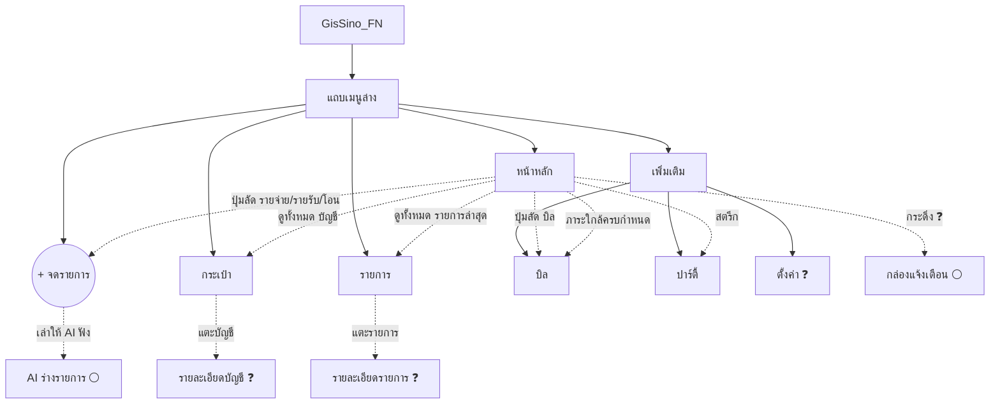

# แผนที่ระบบ GisSino — มีอะไรแล้ว / จะมีอะไร

> ไฟล์นี้เขียนให้ **เจ้าของโปรเจกต์อ่าน** เพื่อดูภาพรวมว่าตอนนี้ระบบมีอะไรแล้วและอะไรยังไม่มี
> ข้อมูลทุกอย่างในแอปตอนนี้เป็น **ข้อมูลจำลอง (mock)** ยังไม่มี backend จริง และยังไม่มีการบันทึกข้อมูลจริง
> ข้อมูลในส่วน "มีแล้ว" มาจากภาพหน้าจอ ณ 2026-10-16 (ไม่ได้อ่านโค้ด) คอลัมน์ "ไปที่" เป็นปลายทางที่คาดจากการออกแบบ ยังไม่ได้ทดสอบกดจริง ส่วน "ยังไม่มี" มาจาก [คู่มือโปรเจกต์](PROJECT_GUIDE.md) §5

**สัญลักษณ์สถานะ**

| สัญลักษณ์ | ความหมาย |
|---|---|
| ✅ | ใช้งานได้จริงกับข้อมูลจริงและทดสอบแล้ว (ตอนนี้ยังไม่มีข้อไหนถึงขั้นนี้) |
| 🟡 | มีหน้าตา (UI) แล้ว แต่เป็นข้อมูลจำลอง ยังใช้งานจริงไม่ได้ |
| ⚪ | ยังไม่มีเลย (วางแผนไว้ในคู่มือ) |
| ❓ | ไม่เห็นในภาพ ต้องเช็กว่ามีหรือยัง |
| 🔴 | ตัดออกโดยตั้งใจ |

---

## 1. แผนผังภาพรวม

เส้นประ = ปุ่มหรือลิงก์ที่พาไปหน้าอื่น เส้นทึบ = อยู่ในเมนูเดียวกัน

---

## 2. รายละเอียดทีละหน้า

### 2.1 ส่วนที่ใช้ร่วมกันทุกหน้า

| ฟังก์ชัน | สถานะ | หมายเหตุ |
|---|---|---|
| แถบแจ้ง "ตัวอย่างข้อมูลสำหรับทดสอบดีไซน์" | 🟡 | ต้องเอาออกเมื่อใช้ข้อมูลจริง |
| แถบเมนูล่าง 4 ปุ่ม + ปุ่ม "+" | 🟡 | หน้าหลัก / กระเป๋า / รายการ / เพิ่มเติม |
| แถบหัว: โลโก้, โหมดมืด, กระดิ่ง, รูปโปรไฟล์ GS | 🟡 | ปุ่มโหมดมืดกับกระดิ่งยังไม่รู้ว่าใช้งานได้ไหม |
| แถบด้านข้างบนจอใหญ่ (ย่อ/ขยายได้) | 🟡 | ตามบันทึก TASK-GS-UI-002 ไม่อยู่ในภาพ |
| ปุ่มซ่อน/แสดงยอดเงิน (รูปตา) | 🟡 | อยู่หน้าหลักและกระเป๋า |

### 2.2 หน้าหลัก

| ฟังก์ชัน | สถานะ | ไปที่ |
|---|---|---|
| ทักทาย "ยินดีต้อนรับกลับ คุณกิส" | 🟡 | |
| ปุ่มถ้วยรางวัล | 🟡 | ❓ ปลายทาง (น่าจะเป็นปาร์ตี้ ต้องยืนยัน) |
| ปุ่มกระดิ่ง | 🟡 | ❓ กล่องแจ้งเตือน |
| การ์ดยอดเงินรวม (THB, ซ่อนได้, ช่วง "เดือนนี้") | 🟡 | |
| ปุ่มลัด: รายจ่าย / รายรับ / โอนเงิน | 🟡 | → แผ่น "+" จดรายการ |
| ปุ่มลัด: บิล | 🟡 | → หน้าบิล |
| บัญชีของฉัน (การ์ดซ้อนกัน เลื่อนดูได้) + ปุ่ม "+" เพิ่มบัญชี | 🟡 | "ดูทั้งหมด" → กระเป๋า / "ดูรายละเอียด" → ❓ รายละเอียดบัญชี |
| รายการล่าสุด 3 รายการ | 🟡 | "ดูทั้งหมด" → รายการ |
| เงินที่ใช้ได้จริง | 🟡 | ตามคู่มือ = เงินที่มี − ภาระที่ยังไม่จ่าย |
| ภาระใกล้ครบกำหนด | 🟡 | → บิล |
| สรุปเดือนนี้ (รายจ่าย + กราฟแท่ง 7 วัน) | 🟡 | |
| การ์ดสตรีก "7 วัน" และสิทธิ์พักสตรีก 2 ครั้ง | 🟡 | → ปาร์ตี้ |

### 2.3 กระเป๋า

| ฟังก์ชัน | สถานะ | ไปที่ |
|---|---|---|
| ยอดรวมบัญชี (ซ่อนได้) | 🟡 | |
| กลุ่ม: บัญชีธนาคาร, อีวอลเล็ต, เงินสด, บัตรเครดิต·ภาระหนี้ | 🟡 | |
| แตะแต่ละบัญชี | 🟡 | ❓ รายละเอียดบัญชี |
| ปุ่ม "เพิ่มบัญชี" และ "โอนเงิน" | 🟡 | |
| ปรับยอดให้ตรงกับแอปธนาคารจริง (reconcile) | ⚪ | ตามคู่มือ Block 1 |
| บัญชีเงินดอลลาร์ (USD) + อัตราแลกเปลี่ยนรายวัน | ⚪ | แหล่งข้อมูลเรทยังต้องตรวจสอบ |

### 2.4 รายการ

| ฟังก์ชัน | สถานะ | ไปที่ |
|---|---|---|
| เลือกเดือน (แสดงเป็น พ.ศ.) | 🟡 | |
| สรุปรายรับ / รายจ่ายของเดือน | 🟡 | |
| ค้นหาชื่อรายการหรือหมวดหมู่ | 🟡 | |
| ตัวกรอง: ทั้งหมด / รายจ่าย / รายรับ / โอนระหว่างบัญชี | 🟡 | |
| รายการจัดกลุ่มตามวัน (วันนี้, เมื่อวาน ...) | 🟡 | |
| แตะรายการเพื่อดู/แก้ไข | ❓ | |
| หมวดหมู่ และแท็ก | ❓ | ตามคู่มือ Block 2 |
| สถานะ "รอเติมรายละเอียด" | ⚪ | แนบสลิปก่อน เติมรายละเอียดทีหลัง |

### 2.5 บิล (เข้าจาก "เพิ่มเติม" หรือปุ่มลัดหน้าหลัก)

| ฟังก์ชัน | สถานะ | หมายเหตุ |
|---|---|---|
| ยอดภาระผูกพันรวมของเดือน | 🟡 | |
| สลับมุมมอง รายการ / ปฏิทิน | 🟡 | เห็นเฉพาะมุมมองรายการ |
| กลุ่ม: บัตรเครดิต, บิลรายเดือน, ผ่อนชำระ | 🟡 | |
| ป้ายสถานะ "ใกล้ถึงกำหนด" / "รอชำระ" | 🟡 | |
| ทำเครื่องหมาย "จ่ายแล้ว" | ❓ | |
| ผ่อนชำระ: นับงวด ปิดแผนอัตโนมัติ | ⚪ | ตามคู่มือ Block 3 |
| สมัครสมาชิกรายเดือน/ปี ตัดรายจ่ายให้อัตโนมัติ | ⚪ | ตัดสินใจแล้วว่าอัตโนมัติ ไม่ต้องกดยืนยัน |
| เตือน 3 ระยะ (ก่อน 3 วัน / วันครบกำหนด / เลยกำหนด) | ⚪ | |
| ช่องทางแจ้งเตือน: กล่องในแอป, Web Push, อีเมล | ⚪ | |

### 2.6 ปาร์ตี้ (เข้าจาก "เพิ่มเติม")

| ฟังก์ชัน | สถานะ | หมายเหตุ |
|---|---|---|
| โปรไฟล์: เลเวล, XP, แถบความคืบหน้า | 🟡 | |
| บันทึกต่อเนื่อง (สตรีก) และสิทธิ์พักสตรีก | 🟡 | พักอัตโนมัติ แบบ Duolingo |
| เหรียญความสำเร็จ (ปลดล็อก / ล็อก) | 🟡 | |
| อันดับสม่ำเสมอประจำสัปดาห์ | 🟡 | จัดอันดับด้วยนิสัย ไม่ใช้จำนวนเงิน |
| ป้ายอธิบาย "แชร์กำลังใจ ไม่แชร์ยอดเงิน" | 🟡 | กฎสำคัญของระบบ |
| ปุ่ม "การมองเห็น" | 🟡 | ตามคู่มือมี 3 ระดับ: ส่วนตัว / เฉพาะสถานะ / เต็ม |
| สมาชิก และปุ่มชวนคนในครอบครัว | 🟡 | ยังไม่มีลิงก์/QR จริง |
| กำลังใจจากปาร์ตี้ (ฟีดกิจกรรม) | 🟡 | |
| สร้างปาร์ตี้ / เชิญด้วยลิงก์หรือ QR จริง | ⚪ | |

### 2.7 แผ่น "+" วันนี้อยากจดอะไร

| ตัวเลือก | สถานะ | หมายเหตุ |
|---|---|---|
| รายจ่าย | 🟡 | จดทีละรายการด้วยตัวเอง |
| รายรับ | 🟡 | |
| โอนเงิน (ระหว่างบัญชีของคุณ) | 🟡 | ไม่นับเป็นรายจ่าย |
| แนบสลิป | 🟡 | **เก็บรูปไว้เท่านั้น ห้ามสแกน/OCR** |
| วันนี้ไม่ใช้จ่าย | 🟡 | ใช้เป็นกิจกรรมนับสตรีก |
| เล่าให้ AI ฟัง | 🟡 | AI ร่าง → คนกดยืนยัน (ยังไม่มี AI จริง) |

### 2.8 ไม่อยู่ในภาพที่ส่งมา (ต้องเช็กว่ามีหรือยัง)

- หน้า "เพิ่มเติม" และ "ตั้งค่า" (บันทึกของ Codex มีหน้าโน้ตสองหน้านี้ แต่ไม่เห็นหน้าตา)
- หน้าเข้าสู่ระบบ / สมัครสมาชิก (Passkey, อีเมล+รหัสผ่าน)
- กล่องแจ้งเตือน, รายละเอียดบัญชี, รายละเอียดรายการ

---

## 3. ฟังก์ชันที่ยังไม่มีเลย (จากคู่มือ)

| กลุ่ม | ฟังก์ชัน | สถานะ |
|---|---|---|
| รากฐาน | เข้าสู่ระบบแบบเชิญเท่านั้น, Passkey, แยกข้อมูลรายผู้ใช้ | ⚪ |
| รากฐาน | ติดตั้งเป็นแอป (PWA) + วิธีติดตั้งรายเครื่อง | ⚪ |
| รากฐาน | สำรองข้อมูลอัตโนมัติ + ทดสอบกู้คืนจริง | ⚪ |
| รากฐาน | ยกเลิกการลบ (undo), แผงผู้ดูแลของเจ้าของ | ⚪ |
| AI | ถามตอบอ่านอย่างเดียว เช่น "เดือนหน้ามีบิลอะไรบ้าง" | ⚪ |

**ตัดออกโดยตั้งใจ 🔴:** สแกนสลิป/ใบเสร็จ (OCR), จดด้วยเสียง, งบซองเต็มรูปแบบ, ลงทุน/พอร์ต, แผนปลดหนี้, ภาษี, พยากรณ์, API สาธารณะ, เชื่อมข้อมูลธนาคาร, หนี้ระหว่างสมาชิก

---

## 4. ข้อสังเกตที่ควรตัดสินใจ

1. **ยอดรวมยังไม่หักหนี้บัตร:** ยอดรวม ฿116,850 คือผลรวมเงินในบัญชี ส่วนบัตรเครดิต ฿8,250 แยกอยู่ต่างหาก ต้องตัดสินใจว่าจะโชว์ "ยอดรวม" หรือ "สินทรัพย์สุทธิ" (หักหนี้แล้ว)
2. **"เงินที่ใช้ได้จริง" ฿14,500:** ตามคู่มือต้องเท่ากับเงินที่มี − ภาระที่ยังไม่จ่าย ตัวเลขชุดจำลองตอนนี้ยังไม่ใช่การคำนวณจริง
3. **ปุ่มถ้วยรางวัลและกระดิ่ง** บนหน้าหลัก ยังไม่ระบุปลายทางในเอกสาร

---

## 4.5 สิ่งที่ตัดสินใจเพิ่มเมื่อ 2026-10-17 (ยังไม่มี UI ทั้งหมด)

รายละเอียดเต็มและเหตุผลอยู่ใน [HOME_AND_LEADERBOARD_SPEC.md](HOME_AND_LEADERBOARD_SPEC.md)

| หน้า | ฟังก์ชัน | สถานะ | หมายเหตุ |
|---|---|---|---|
| หน้าหลัก | แถบ "วันนี้" (บิลใกล้ครบ, สตรีกเสี่ยง, รายการรอเติมรายละเอียด) ซ่อนเมื่อไม่มีอะไร | ⚪ | |
| หน้าหลัก | ภาระใกล้ครบกำหนดระบุรายการที่ใกล้ที่สุด | ⚪ | ปรับจากของเดิม |
| หน้าหลัก | การ์ดสตรีกแสดงอันดับปาร์ตี้ 1 บรรทัด | ⚪ | ปรับจากของเดิม |
| หน้าหลัก | สรุปเดือนนี้เหลือบรรทัดเดียว | ⚪ | ย้ายของเต็มไปแท็บสรุป |
| หน้าหลัก | กระดานจัดอันดับ Global แบบย่อ (ตัวกรองหมวดอายุ + ช่วงเวลา) | ⚪ | |
| รายการ | แท็บ "สรุป" (ยอดรายรับ/รายจ่าย + กราฟ 7 วัน) | ⚪ | |
| หน้าใหม่ | หน้าจัดอันดับ: แท็บ Global / เพื่อนของฉัน, หมวดอายุ, วัน/สัปดาห์/เดือน/ปี | ⚪ | แสดงลำดับอย่างเดียว ไม่มีผู้ชนะ ไม่มี XP |
| หน้าใหม่ | เพื่อน: ค้นหาด้วยชื่อหรือรหัส 6 หลัก, คำขอ, รายชื่อ | ⚪ | ไม่มีแนะนำเพื่อนตามเพศ/อายุ |
| ปาร์ตี้ | สร้างปาร์ตี้ และสร้างครอบครัว | ⚪ | ความสัมพันธ์ของสองอย่างนี้ยังรอตัดสินใจ |
| สมัครใหม่ | ขั้น "เกี่ยวกับคุณ" (ปีเกิด, เพศ) + หน้ายินยอมข้อมูล | ⚪ | PDPA/ผู้เยาว์ ต้องตรวจ |
| หลังตั้งค่า | โปสการ์ดต้อนรับ (โชว์ครั้งเดียว) | ⚪ | |
| ภายหลัง | ประกาศ "มีอะไรใหม่" แบบเก็บเป็นข้อมูล + แจ้งเวอร์ชันใหม่ของแอป | ⚪ | ไม่ต้อง deploy ใหม่เมื่อเพิ่มประกาศ |

**คำถามที่รอเจ้าของตอบ:** กระดานใช้จ่ายจัดอันดับด้วยจำนวนเงินหรือ % ของรายได้, ช่วงอายุและหมวด "เด็ก", อายุขั้นต่ำ, การใช้ข้อมูลเพศ, ครอบครัวกับปาร์ตี้ต่างกันไหม (ดูข้อ 11 ในไฟล์สเปก)

---

## 5. วิธีใช้และอัปเดตไฟล์นี้

- เมื่อเพิ่มหรือเปลี่ยนฟังก์ชัน ให้แก้แถวในตารางของหน้านั้น และเปลี่ยนสัญลักษณ์สถานะ (⚪ → 🟡 → ✅ เมื่อใช้ข้อมูลจริงแล้ว)
- ฟังก์ชันที่พาไปหน้าอื่น ให้เพิ่มเส้นประในแผนผังข้อ 1
- เพิ่มบรรทัดใน Change log ด้านล่างทุกครั้ง
- สถานะ ✅ ใช้เมื่อฟังก์ชันทำงานกับข้อมูลจริงและทดสอบแล้วเท่านั้น

## Change log

- 2026-10-16 — สร้างไฟล์จากภาพหน้าจอ UI จำลองและคู่มือโปรเจกต์ ยังไม่ได้ตรวจกับโค้ดจริง
- 2026-10-17 — เพิ่มข้อ 4.5 รายการที่ตัดสินใจเพิ่ม (หน้าหลัก v2, กระดานจัดอันดับ, เพื่อน, ขั้นสมัคร, โปสการ์ด) ยังไม่มี UI
