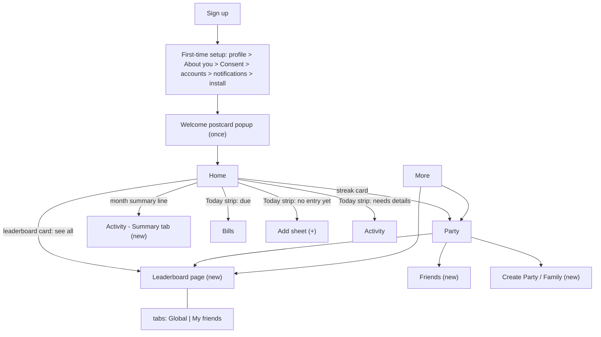

# Change Spec — Home v2, Leaderboard, Friends, Onboarding, Announcements

> **Audience:** the implementation agent (ChatGPT-written task prompts → Codex / Claude Code) and the owner.
> **Stage:** mock-data UI prototype. Nothing here is implemented yet. Every number shown in the UI must be labeled sample data. Never present mock data as real.
> **Source:** owner decisions from the design discussion on 2026-10-17, plus analyst proposals. Tags: **[DECIDED]** = owner said so · **[PROPOSED]** = analyst default, use it and say so · **[OPEN]** = do not assume, ask the owner.
> **Scope rule:** this file records changes; it does not authorize skipping the vault rules. Apply it through normal tasks (one slice = one task = one Draft PR). Do NOT silently rewrite the guide or architecture; section 9 lists the edits to make in a docs task.

---

## 1. Summary of what changes

| Area | Change |
|---|---|
| Home | Re-ordered; new **Today strip**; nearest obligation named; streak card shows party rank; monthly summary reduced to one line; new compact **global leaderboard** card at the bottom |
| Activity (รายการ) | New **Summary** tab that receives the monthly summary and 7-day chart moved off Home |
| Leaderboard | New page: tabs **Global** and **My friends**; boards for Overall and age categories; period switch day / week / month / year |
| Friends and groups | New: add friends by name or 6-digit code, requests, friend list; create a Party or a Family |
| Onboarding | New "About you" step (birth year, gender, optional income range) and a consent step; ends with a welcome postcard popup |
| Announcements | Welcome postcard now; data-driven "what's new" popups and PWA update prompt later |
| Bottom navigation | **Unchanged**: Home / Wallet / Activity / More + Add. New pages are reached from Home, Party and More |

---

## 2. Decisions recorded (owner, 2026-10-17)

| # | Decision | Tag |
|---|---|---|
| D-A | Home gets a **Today strip** (due soon, streak at risk, entries needing details); hidden entirely when empty | DECIDED |
| D-B | "Upcoming obligations" tile names the **nearest** item and its days left, not only a total | DECIDED |
| D-C | Streak card shows one line of party rank, e.g. "สตรีก 7 วัน · ปาร์ตี้ที่ 2", tap opens Party | DECIDED |
| D-D | Monthly summary + 7-day chart leave Home; Home keeps a one-line link; full version lives in a Summary tab in Activity | DECIDED (direction) · PROPOSED (tab placement) |
| D-E | Leaderboards have four age-based categories plus an Overall board, so students are not ranked only against workers or retirees. Category comes from the user's age | DECIDED |
| D-F | The age selection includes **children** | DECIDED (see Q2 for exact bands) |
| D-G | Collect **age (birth year)** and **gender** at first-time setup, with an explicit consent step. Owner accepts the PDPA risk because users are invited people the owner trusts | DECIDED (see Q3, Q4) |
| D-H | Leaderboards **show position only**: no winner, no XP, no badges from spending ranks | DECIDED |
| D-I | Leaderboards include **spending** rankings by day / week / month / year, updated in near real time | DECIDED (metric: see Q1) |
| D-J | Home shows **only the Global board** (compact). Everything else is on a separate Leaderboard page with two tabs: **Global** and **My friends** | DECIDED |
| D-K | Friends are added by **user name or a random 6-digit code** | DECIDED (safeguards PROPOSED, section 6) |
| D-L | Users can create a **Party** and a **Family** | DECIDED (relationship between them: see Q5) |
| D-M | Notifications stay as planned (later). Now: a **welcome postcard** popup on first entry | DECIDED |
| D-N | Announcements ("what's new") are **data, not code**, added later without redeploying | DECIDED (design PROPOSED) |

---

## 3. Home v2

### 3.1 Order (top to bottom)

| # | Block | Status vs current mock |
|---|---|---|
| 1 | Greeting, trophy button, bell button (unread dot) | existing |
| 2 | Total balance card (hide/show) | existing |
| 3 | Quick actions: รายจ่าย / รายรับ / โอนเงิน / บิล | existing |
| 4 | **Today strip** | new |
| 5 | Safe-to-spend tile + Nearest-obligation tile | changed |
| 6 | Streak card with party-rank line | changed, moved up |
| 7 | My accounts (carousel) | existing |
| 8 | Recent transactions (3) | existing |
| 9 | Month summary, **one line** with chevron | moved (full version → Activity Summary tab) |
| 10 | **Global leaderboard card** (compact) | new |
| 11 | *(optional, PROPOSED)* Weekly mission card, e.g. "2/3" — the guide §6.2 already lists weekly missions | new, optional |
| popup | Welcome postcard (first entry only) | new |

Do not add more blocks. Home is a glance, not a dumping ground.

### 3.2 Block contract

| Block | Data (mock now, real later) | Tap goes to | Empty / edge state |
|---|---|---|---|
| Today strip | Obligations due within 3 days or overdue; "no qualifying entry today" after the user's reminder time; count of entries with status "needs details" (รอเติมรายละเอียด) | due → Bills; no entry → Add sheet; needs details → Activity filtered | No items → strip is **not rendered** |
| Safe to spend | Money in non-credit accounts − unpaid obligations this month (guide Block 1) | Wallet | Shows ฿0 with hint if negative; never hides the figure |
| Nearest obligation | Earliest unpaid due date: name, amount, days left | Bills (item highlighted) | "ไม่มีภาระใกล้ครบกำหนด" |
| Streak + rank line | `user_stats` streak; rank of the user in their **primary party** by current streak [PROPOSED] | Party | No party yet → hide the rank part, keep streak |
| Month summary line | This month's expense total | Activity → Summary tab | No data → "ยังไม่มีรายการเดือนนี้" |
| Global leaderboard card | Aggregate stats only (see section 5) | Leaderboard page | Not opted in → card with "เข้าร่วมกระดาน" call to action; no ranks shown |

### 3.3 Global leaderboard card (Home)

- Category chips: **รวม** + the age categories (section 5.2). Period chips: วัน / สัปดาห์ / เดือน / ปี.
- Shows top 3 plus the current user's own row. Row = rank, nickname, avatar, category badge. Money values are **not** shown unless the member chose to show amounts (section 5.4).
- Only the Global board appears on Home. "ดูทั้งหมด" opens the Leaderboard page.
- Footer label while mock: "ตัวอย่างข้อมูลสำหรับทดสอบดีไซน์".

---

## 4. New and changed pages

### 4.1 Activity → Summary tab
Tabs: "รายการ | สรุป". Summary holds the month picker result, income vs expense, the 7-day bar chart, and later category breakdown. Use existing chart/components; check the component inventory before creating anything.

### 4.2 Leaderboard page (new)
- Route reachable from Home card, Party page, More.
- Two tabs: **Global** | **เพื่อนของฉัน** (My friends). On the friends tab, a selector lets the user choose All friends / a specific Party / Family [PROPOSED].
- Filters: category (Overall + age categories), period (day / week / month / year), metric (see Q1; also habit boards: streak, active days, on-time rate, weekly XP).
- Display rule (D-H): position only. No winner banner, no confetti, no XP or badge for spending boards. Habit boards may keep the existing weekly XP system.
- Refresh: recompute when a member's data changes; viewers see it on opening the page and by polling every 30–60 s [PROPOSED]. No WebSocket needed at this scale. VERIFY whether the Cloudflare Tunnel setup would matter if WebSockets are ever wanted.

### 4.3 Friends (new, under Party)
- Add by exact user name or by 6-digit code. Send request → recipient accepts or declines → friends list. Remove friend, block user [PROPOSED].
- Search result shows only nickname and avatar. Never age, gender, balances or party stats before acceptance.
- Safeguards [PROPOSED]: exact-match search only (no browsing or partial-name search, to prevent listing all users); rate limit on searches and requests; the 6-digit code is unique across the app, random, regenerable by the owner of the account; blocked users cannot search or request.
- **No "suggested friends" by age or gender** (analyst recommendation; the owner's own description of friend adding used name/code search only).

### 4.4 Party and Family creation (new)
- A user can create a **Party** (named group of friends, invite by friend list, link or QR) and a **Family** (see Q5). Joining or leaving never exposes or changes the user's own data (existing invariant).
- Existing Party page keeps: level/XP, streak, medals, weekly board, visibility button, members, feed.

### 4.5 Visibility ("การมองเห็น")
Per member, extends the existing three levels (guide §5 Block 6 / §6.4):
- **Private:** not shown, not ranked.
- **Status only:** nickname, category, habit stats and ranks; no money values. **Default for habit stats.**
- **Full:** also money-related figures the user turns on one by one.
Joining the **spending** boards is a separate **opt-in** switch, off by default [PROPOSED].

---

## 5. Leaderboard logic

### 5.1 Hard rule that does not change
The leaderboard/party layer reads **only aggregate stats tables** (`user_stats` and related), never `transactions`, `accounts` or `attachments`. Spending ranks are computed from aggregate columns that the stats job writes, not from raw rows.

### 5.2 Categories from age [PROPOSED boundaries — see Q2]
| Category | Age (derived from birth year) |
|---|---|
| Child (เด็ก) | up to 12 |
| Youth / student (วัยรุ่น / นักเรียน-นักศึกษา) | 13 – 22 |
| Working age (วัยทำงาน) | 23 – 59 |
| Retired (วัยเกษียณ) | 60 and over |
| Overall (รวม) | everyone who opted in |

The category is computed, not typed. Others see the category, never the exact age or birth year.

### 5.3 Metrics
| Board type | Metric | Notes |
|---|---|---|
| Habit | current streak, longest streak, active days in last 30, on-time payment rate, details-completeness, weekly XP | As in guide §6.3 |
| Spending | per period (day / week / month / year) — **metric undecided, see Q1** | Informational only; no XP, no badges; spending is never a reason to award anything (guide §6.2 stays) |

Ranking input for spending, once the metric is chosen, is a value in integer minor units (THB-normalized using the daily rate) or a percentage. Money = integer minor units + currency; no floats.

### 5.4 What others can see
Nickname, avatar, category, rank. Amounts only if that user chose Full **and** enabled that figure. Itemized transactions are never shared at any level. Gender is not shown anywhere and is not used in ranking (see Q4).

### 5.5 Ties and ordering
Equal values share a rank. A member who opts out disappears from every board and the ranks close up. Brand-new members with no data are listed unranked.

---

## 6. Onboarding (first-time setup)

Flow: Welcome → Log in / Sign up (invite only) → **First-time setup** → Home.

Setup steps in order:
1. Profile: name, nickname (display name), avatar *(existing)*
2. **About you (new):** birth year → shows derived category; gender (options include "ไม่ระบุ"); **monthly income range — only if Q1 selects a percentage metric; skippable, private, never shown to others**
3. **Consent (new):** short plain-Thai notice of what is collected (birth year, gender, income range if asked, money data, slip images), why, who can see what, and how to delete the account. A checkbox must be ticked to continue. For a child member the inviting adult confirms [PROPOSED]. Legal wording and minor rules: VERIFY under Thailand's PDPA before production; do not claim compliance.
4. Add first accounts *(existing)*
5. Choose notification method *(existing)*
6. How to install the app *(existing)*
7. Finish → **welcome postcard** popup, shown once

Notes: the owner mentioned the file-upload feature (slip attachments) in the same breath as collecting age data. Interpreted as: the consent notice must also cover stored uploaded files. Confirm with the owner if a different meaning was intended.

---

## 7. Announcement system

| Type | Mechanism | Redeploy needed |
|---|---|---|
| Welcome postcard | `welcome_seen_at` flag on the user; modal shown once after setup | No |
| What's new / maintenance notice | Rows in an `announcements` table (title, body, kind, starts_at, ends_at, audience, version) plus `announcement_reads` (user, announcement, seen_at, dismissed_at). The app fetches active, unseen rows on start and shows a modal or banner. Owner creates them in the admin panel | **No** |
| New app version available | PWA service worker detects a new build and shows an "update available — tap to refresh" bar | Yes (happens on deploy) |

Principle: announcements are **data, not code**, so they can be added to the live app without touching it. Build order: welcome postcard now (mock); the table and admin form later, with the admin panel (guide Block 7) and inbox (milestone M6). Announcements may also appear in the in-app inbox.

---

## 8. Data model changes to propose (architecture file)

All **[PROPOSED]**; add to `SYSTEM_ARCHITECTURE.md` through a docs task, not silently.

- `users` / profile: `birth_year`, `gender` (nullable, includes "unspecified"), `income_band` (nullable, private), `consented_at`, `consent_version`, `friend_code` (6 digits, unique, random), `welcome_seen_at`.
- Derived: `age_category` (computed from birth year; never stored as free text).
- `friendships` (user_id, friend_id, status `pending|accepted|blocked`, created_at).
- `parties` (id, name, kind `party|family`, created_by) and the existing `party_members`.
- `user_stats` extended with period aggregates for the spending boards and two flags: `ranking_opt_in`, `spending_board_opt_in`, `show_amounts`. Remains **the only table the party/leaderboard layer reads**.
- `announcements`, `announcement_reads` (later).
- Every query scoped to the authenticated user; add **cross-user access tests**, including: user A cannot read user B's transactions, accounts or attachments through any leaderboard or friends endpoint; a non-friend cannot see more than nickname and avatar; blocked users cannot search or request.

---

## 9. Edits to make in other documents (docs task, owner approval)

1. **Guide §6.4 invariant 2** currently says rankings never use balance, income, spending or net worth. Replace with: "Habit boards never use money. **Spending boards are allowed** as informational boards only: opt-in, aggregate-table-only, position shown (amounts only with Full), no XP and no badges." Record it in `DECISIONS.md` as superseding the old wording. Keep invariants 1, 3, 4, 5, 6.
2. **Guide §5 Block 6:** replace "family party" framing with friends + party + family + global/age-category boards; mark spending boards as new scope.
3. **Guide §10 / architecture §8 (first-time setup and navigation):** add the "About you" and consent steps; update the navigation map to the real nav (Home / Wallet / Activity / More + Add; More contains Bills and Party) with the new Leaderboard, Friends and Summary-tab routes. This also supersedes guide D14's older 5-slot proposal.
4. **Architecture §7.7–7.8 and data model:** section 8 above.
5. **Page notes:** update Page-Home, Page-Activity, Page-Party; add Page-Leaderboard and Page-Friends. Set their status to `PROTOTYPE (mock data)` only after the slice ships.
6. **FEATURE_MAP.md:** mark the new rows ⚪ now, 🟡 when each slice ships.
7. Add the open questions below to `OPEN_QUESTIONS.md`.

---

## 10. Build slices (mock data only; one slice per task and per Draft PR)

| Slice | Content | Done when |
|---|---|---|
| S1 | Home v2: reorder, Today strip, nearest obligation, streak + rank line, one-line month summary (placeholder link) | Home matches section 3; empty states work; `npm run check` and `npm test` pass; screenshots on mobile and desktop |
| S2 | Activity Summary tab (receives the moved summary + chart) | Link from Home works; no duplicate chart code |
| S3 | Leaderboard page with Global and My-friends tabs, categories, period chips, mock members | Position-only display; no XP/badge on spending boards; opt-in states |
| S4 | Home global leaderboard card | Uses the same component as S3 |
| S5 | Friends: search by name/code, requests, list; Party and Family creation (mock) | Exact-match search; nothing but nickname/avatar before acceptance |
| S6 | Onboarding "About you" + consent + welcome postcard | Category derived from birth year; consent required to continue; postcard shows once |
| S7 | Docs sync (section 9) | Vault health checks pass |

Rules for every slice: check for existing components before creating new ones; Thai copy goes through the i18n catalog; label all sample data; do not add anything not in this file without asking; report what was run and what was not.

---

## 11. Open questions for the owner

| # | Question | Analyst default |
|---|---|---|
| Q1 | What does a spending board rank? (a) absolute amount spent within the category, or (b) percentage of the user's own income spent / saved. And does "lower" or "higher" rank first? | Recommend (b), because it is comparable across categories and the Overall board; needs the income range question in onboarding. If (a), keep the Overall board labeled as not comparable |
| Q2 | Exact age bands, and is **Child** its own board (5 boards total) or merged into Youth (4 boards)? | Child ≤ 12, Youth 13–22, Working 23–59, Retired 60+; Child merged into Youth for ranking until there are enough child users |
| Q3 | Minimum age to sign up, and how a child's consent is handled | Inviter confirms for a child; set a minimum age once decided. PDPA rules for minors: VERIFY |
| Q4 | What is gender used for? Data should have a purpose | Collect (owner decision) but store only; not displayed, not used in ranking; make it optional with "ไม่ระบุ" |
| Q5 | Is **Family** a separate thing from **Party**, or a party of kind `family`? | One mechanism, two kinds, to avoid building the same system twice |
| Q6 | Spending boards: opt-in (default off) or everyone included by default | Opt-in, default off |
| Q7 | Who can see the Global board: every user of the app, once opted in? | Yes, nickname + category + rank only |
| Q8 | Which board decides the rank in the streak line on Home? | The user's primary party; hidden if none |

---

## Change log

- 2026-10-17 — Created from the owner's decisions of this date. Not yet applied to the guide, architecture or code.
